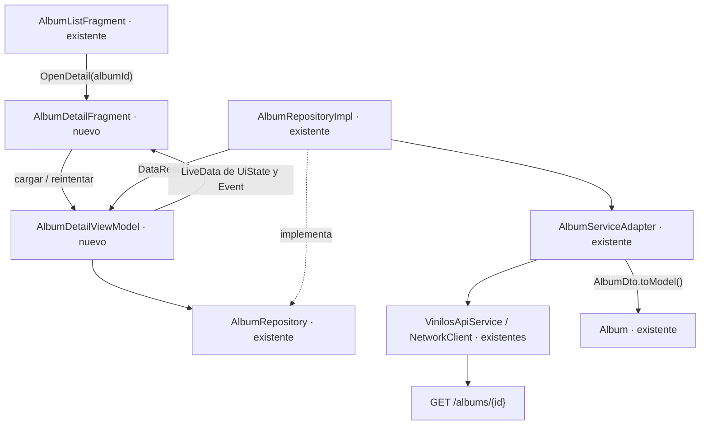

# 11. HU02 · Diseño técnico del detalle de álbum

Estado: diseño de referencia para implementar por tareas; avance registrado en la sección 8.
Tarea: [HU02-01 · #13](https://github.com/misw-is-aplicaciones-moviles/MobileVynils/issues/13).
Responsable: @ManfredAriel91122.
Base revisada: `develop`, commit `5f2399e`, con HU01-03 integrada.

## 1. Alcance

Como usuario visitante quiero ver el detalle de un álbum para ampliar su información.
La pantalla consulta `GET /albums/{id}` y muestra portada, nombre, artista principal,
género, fecha, sello, descripción, canciones con duración y comentarios con calificación.
La consulta también está disponible para el rol coleccionista.

Incluye navegación desde una tarjeta real del catálogo, regreso, carga, error,
álbum inexistente y reintento. Las canciones y los comentarios pueden estar vacíos.

Agregar canciones pertenece a HU08, publicar comentarios a HU09 y abrir el detalle
del artista a HU04. HU02 no agrega estas operaciones ni controles sin acción.
Tampoco agrega accesos de depuración, dependencias nuevas, tablas, migraciones
o cambios del tema global.

Referencias: [arquitectura](02-arquitectura.md),
[reglas de interfaz](05-reglas-de-diseno-ui.md),
[pruebas](06-pruebas.md) y [especificación funcional](10-diseno-de-la-aplicacion.md).

## 2. Reutilización de la base existente

| Elemento de develop | Uso en HU02 | Cambio mínimo previsto |
|---|---|---|
| `VinilosApiService` | Consultar el backend | Añadir el endpoint de detalle |
| `AlbumServiceAdapter` y su implementación | Obtener DTO y mapear a dominio | Añadir la consulta por ID manteniendo proveedor y dispatchers |
| `AlbumRepository` y su implementación | Puerta de datos del ViewModel | Añadir `getAlbum` utilizando `networkRequest` |
| `AlbumDto`, DTO anidados y mappers | Deserializar álbum, canciones, artistas y comentarios | Reutilizar; solo ampliar la imagen opcional del artista si la respuesta la entrega |
| `Album`, `Track`, `Comment`, `PerformerSummary` y `Genre` | Datos de la pantalla | Conservar los tipos; imagen opcional en `PerformerSummary` para su avatar |
| `NetworkClient`, `DataResult` y `DataError` | HTTP y clasificación de errores | Reutilizar sin otra infraestructura |
| `AppContainer` | Entregar el repositorio y la sesión | Reutilizar sus instancias y constructores |
| `AlbumListEvent.OpenDetail(albumId)` | Entrada desde el catálogo | Conectar su manejador, actualmente vacío |
| `view_header`, `PaperSheetLayout` y estados compartidos | Cabecera, fondo, carga y error | Componer el detalle con los recursos existentes |
| `VinylArtworkView`, Glide y RecyclerView | Portada con disco y contenido desplazable | Usar componentes y dependencias ya presentes |
| Estilos, fuentes, colores y dimensiones | Apariencia del wireframe | Derivar únicamente estilos y medidas específicos del detalle |
| `SessionRepository`, `Event` y navegación de rol | Chip de rol existente | Reutilizar el comportamiento a través del ViewModel |
| Fakes, reglas JUnit, MockWebServer y utilidades Espresso | Verificar la historia | Extender los apoyos existentes, sin otra infraestructura de pruebas |

Room v2 sigue gestionando la caché del catálogo. Su mapper reconstruye un resumen
sin canciones, artistas ni comentarios; el detalle completo se obtiene del endpoint.
HU02 no amplía la persistencia ni promete disponibilidad offline del detalle.
La caché HTTP existente mantiene su configuración.

## 3. Componentes y flujo de datos



1. El catálogo emite el evento existente con el ID de la tarjeta seleccionada.
2. Su Fragment navega al detalle enviando solamente `albumId: Int`.
3. La Factory obtiene el ID desde `SavedStateHandle` y el repositorio desde `AppContainer`.
4. El ViewModel pide el álbum; el adaptador resuelve el servicio en el dispatcher de E/S
   y aplica el mapper en el dispatcher de cálculo, como hace la consulta del catálogo.
5. El repositorio convierte los errores esperados mediante `networkRequest`.
6. El ViewModel publica el estado y la vista lo dibuja. Reintentar repite la consulta.

La consulta de catálogo y su política de caché conservan su comportamiento.

## 4. Contratos mínimos propuestos

Las firmas siguientes se implementan en HU02-02, sobre las clases existentes:

```kotlin
// AlbumRepository: contrato previsto también en docs/02.
suspend fun getAlbum(
    id: Int,
    forceRefresh: Boolean = false,
): DataResult<Album, DataError>

// AlbumServiceAdapter: el Repository convierte sus excepciones.
suspend fun getAlbum(id: Int, forceRefresh: Boolean = false): Album

// VinilosApiService: Response permite validar un cuerpo nulo sin perder el estado HTTP.
@GET("albums/{id}")
suspend fun getAlbum(
    @Path("id") id: Int,
    @Header("Cache-Control") cacheControl: String? = null,
): Response<AlbumDto>
```

El reintento utiliza el encabezado `no-cache` para revalidar la caché HTTP existente.
El adaptador convierte un HTTP fallido en `HttpException` y un cuerpo nulo en error
de serialización; `networkRequest` produce el `DataError` correspondiente.
Un ID recibido distinto del solicitado también se trata como serialización inválida.
`CancellationException` se propaga. Un argumento de navegación ausente o no positivo
es un error de contrato y no inicia una petición.

Las fechas mantienen la conversión UTC de los mappers existentes. La vista presenta
una fecha corta localizada. El conteo de canciones se obtiene de `tracks.size`.
El artista principal es el primer `performer`; si falta, se muestra «Sin artista».
Según el hallazgo 1 de docs/10, el backend no entrega el autor del comentario:
se muestra «Coleccionista», sin inventar nombres ni consultar otros endpoints.

## 5. Estado, ciclo de vida y navegación

`AlbumDetailUiState` contiene únicamente `album: Album?`, `isLoading: Boolean`,
`error: DataError?` y `role: UserRole?` para el chip compartido.
El estado es inmutable y se publica mediante LiveData de solo lectura.
La sesión se combina en el ViewModel siguiendo el patrón existente de HU01.

| Situación | Presentación |
|---|---|
| Carga inicial | Estado compartido de carga |
| Respuesta válida | Información del álbum y sus secciones |
| Sin canciones o comentarios | Mensaje vacío en esa sección, manteniendo el álbum |
| Error de conexión o backend | Estado compartido de error y botón Reintentar |
| HTTP 404 | «No encontramos este álbum» y posibilidad de volver al catálogo |
| Fallo de la portada | Imagen de respaldo, manteniendo los datos del álbum |
| Rotación | Redibujar el estado conservado sin duplicar la solicitud |

El ViewModel carga una vez por instancia y evita solicitudes simultáneas.
El Fragment observa con `viewLifecycleOwner` y libera binding y adaptador al destruirse.
El cambio de rol usa el evento y la navegación compartida al selector.

Se añaden `albumDetailFragment`, su argumento obligatorio `albumId` y la acción
`action_albumList_to_albumDetail` al grafo existente.
Atrás vuelve al catálogo conservando su estado. La barra inferior permanece visible,
Álbumes sigue seleccionado y tocar de nuevo Álbumes regresa a su raíz.
`MainActivity` solo requiere el ajuste de asociación del destino detalle con esa pestaña.
El detalle usa `PrimaryActionHost.hidePrimaryAction()` para no conservar el botón
de crear álbum del catálogo; HU08/HU09 conectarán sus propias acciones.

## 6. Interfaz basada en el wireframe

Referencias revisadas: exportaciones de Figma `HU02 · Detalle de álbum.pdf`
y `Sistema de diseño.pdf`, facilitadas por el responsable en
`/home/kausaustralis/Descargas/Vynils/`. El detalle mide 390 × 1240 en la exportación;
la implementación se adapta al ancho y permite scroll, sin fijar esa altura.

- Reutilizar la cabecera con Atrás y el chip de rol exigido por la aplicación.
- Reutilizar la hoja de papel y la portada con disco, cargada mediante Glide.
- Mantener Montserrat para título y etiquetas, y Outfit para cuerpo y valores.
  El título grande del detalle deriva un estilo propio: no modifica
  `TextAppearance.Vinilos.AlbumTitle`, que ya usa el catálogo a 14 sp.
- Mostrar género/año, título, artista y tres fichas: Sello, Lanzamiento y Canciones.
  Si se necesita una ficha reutilizable, crear un único layout para sus tres usos.
- Usar una sola RecyclerView con filas de cabecera, sección, canción y comentario.
  Crear únicamente las filas que no existen: canciones y comentarios del detalle.
- Numerar canciones como 01, 02; duración a la derecha y separadores suaves.
- Mostrar comentarios con borde redondeado, avatar decorativo, autor disponible,
  estrellas y descripción. El nombre del ejemplo del PDF no se fija como dato real.
- Conservar colores, tipografía, tema global y componentes compartidos de develop.
  Los recursos adicionales se limitan al detalle.
- Mantener objetivos táctiles de 48 dp, encabezados accesibles, texto en recursos
  y adaptación a fuente al 200 %.

El PDF incluye acciones de otras historias: «Comentar», «+» y navegación al artista.
Su comportamiento queda fuera de HU02; no se implementan formularios ni botones
inactivos para simular esas funcionalidades.

## 7. Criterios de verificación y secuencia de tareas

| Tarea | Resultado que permite avanzar |
|---|---|
| HU02-01 · #13 | Alcance, reutilización, componentes y flujo documentados, sin código de aplicación |
| HU02-02 · #14 | Consulta por ID con los contratos compartidos; catálogo y sus pruebas conservados |
| HU02-03 · #15 | Detalle según el wireframe y navegación desde una tarjeta real del catálogo |
| HU02-04 · #16 | Pruebas de carga, ID válido, 404, error, reintento, secciones vacías y solicitud activa |
| HU02-05 · #17 | E2E catálogo → detalle → regreso, rotación y estados de pantalla |
| HU02-06 · #18 | Pruebas del endpoint: ruta, contenido, 404, errores, JSON inválido y cuerpo nulo |

Cada tarea parte de `feature/HU02-detalle-album` actualizada. Tras verificar su alcance
y sus pruebas, se integra en esa rama; entonces se crea la siguiente rama de tarea.
La integración final hacia develop se hace cuando la historia esté verificada.
Los mensajes de commit se redactan en español, con prefijo Conventional Commits.

Base técnica verificada antes de HU02-01: 72 pruebas unitarias correctas y
`spotlessCheck detekt lintDebug testDebugUnitTest assembleDebug` satisfactorios
en develop 5f2399e. Es evidencia de la base, no de funcionalidades todavía por implementar.
La pantalla nueva deberá validarse con los checks del repositorio, instrumentadas,
API 21/37, rotación y fuente grande, conforme a docs/05 y docs/06.

## 8. Avance de HU02-02 · Consulta por ID

Implementada la consulta `GET /albums/{id}` mediante el servicio, adaptador y
repositorio existentes. El adaptador conserva el proveedor diferido y los dispatchers.
El repositorio reutiliza `networkRequest`, valida el ID y devuelve el álbum completo
sin leer ni escribir la caché de Room del catálogo.

Se reutilizan los DTO y mappers. La única ampliación de datos es la imagen opcional
del artista (`PerformerDto.image` → `PerformerSummary.imageUrl`), presente en las
respuestas de la semilla, para el avatar previsto en el diseño.

Verificación local de esta tarea:

- 82 pruebas unitarias correctas, sin errores ni omisiones: las 72 de la base
  y 10 nuevas sobre la consulta y el campo de imagen opcional.
- Se verifican los datos anidados, la revalidación HTTP, el 404, los cuerpos nulos
  o sin contenido, los errores remotos, la cancelación y los IDs inválidos.
- Se comprueba que la consulta de detalle no lee ni modifica Room.
- Detekt, Android Lint y compilación debug correctos; formato aplicado con Spotless.
- Las pruebas del adaptador simulan el objeto de un álbum a partir del fixture
  existente `api/albums.json`; no se presentan como una consulta al backend real.
  La verificación de API de HU02-06 sigue pendiente.

Esta tarea no modifica ViewModels, navegación, layouts, estilos, AppContainer,
dependencias ni persistencia. La pantalla se implementará en HU02-03.

## 9. Avance de HU02-03 · Pantalla y navegación

Implementados `AlbumDetailViewModel`, su estado y evento de cambio de rol,
`AlbumDetailFragment` y un único `AlbumDetailAdapter` para el contenido desplazable.
La Factory obtiene el ID de SavedStateHandle y utiliza los repositorios del
AppContainer existente. Se resuelven carga, contenido, error, 404 y reintento.

El evento existente del catálogo ahora abre `albumDetailFragment` con el ID de la
tarjeta real. La Activity solo se ajusta para mantener Álbumes seleccionado en el
detalle y volver al catálogo al tocar nuevamente esa pestaña.

Se reutilizan la cabecera, los estados, la hoja con recorte, la carátula con disco,
el chip de rol y la barra inferior. Las tres fichas comparten un solo layout.
Los recursos nuevos tienen nombres específicos del detalle y sus estilos derivan
de los existentes. No se modifican el tema global, los recursos compartidos, la
capa de datos, AppContainer, Room ni las dependencias.

Verificación de esta entrega:

- 84 pruebas unitarias correctas: las 82 anteriores y dos comprobaciones mínimas
  del ViewModel (carga válida y 404).
- Spotless, Detekt, Android Lint, APK debug y APK de pruebas compilados correctamente.
- Una prueba mínima de navegación en tablet DBY-W09, Android 12 (API 31), con la
  semilla de BackVynils: entrar como coleccionista, tocar «Buscando América», revisar
  canciones y comentarios, comprobar que el botón de crear no aparece en el detalle,
  regresar y comprobar que el botón del catálogo vuelve a aparecer.
- La misma prueba pasa con fuente normal y al 200 %. Se revisan capturas de portada
  y comentarios en ambas configuraciones. Fuente y animaciones se restauran al terminar.
- La prueba usa únicamente la navegación del producto, sin IDs de acceso temporal
  ni extras de depuración en la aplicación.

Por restricción del equipo del responsable se utiliza la tablet física; no se
volverán a iniciar emuladores. Esta ejecución no cubre otras versiones de Android.
La cobertura completa del ViewModel y de los flujos se amplía en HU02-04 y HU02-05,
reutilizando las pruebas mínimas ya creadas en lugar de duplicarlas.

### Reproducir en la tablet por USB

Con BackVynils activo en el puerto 3000, usar esta configuración local ignorada por Git:

```properties
sdk.dir=<ruta local del SDK>
vinilos.baseUrl=http://127.0.0.1:3000/
```

Conectar el puerto del backend a la tablet e instalar la aplicación:

```bash
adb -d reverse tcp:3000 tcp:3000
./gradlew installDebug
```

Abrir la app, elegir un rol y tocar una tarjeta del catálogo. Para la comprobación
automatizada, con la tablet como único dispositivo conectado:

```bash
./gradlew connectedDebugAndroidTest \
  -Pandroid.testInstrumentationRunnerArguments.class=co.edu.uniandes.vinilos.ui.AlbumDetailScreenTest
```

Las capturas opcionales se activan con `captureScreenshots=true`; se guardan como
`hu02-03-header.png` y `hu02-03-comments.png` en los archivos privados de la app.
No se toman capturas sucesivas en API 21.

## 10. Avance de HU02-04 · Pruebas unitarias del ViewModel

Ampliada la clase existente
[`AlbumDetailViewModelTest`](../app/src/test/java/co/edu/uniandes/vinilos/viewmodels/AlbumDetailViewModelTest.kt),
reutilizando `FakeAlbumRepository`, `FakeSessionRepository`,
`MainDispatcherRule`, `InstantTaskExecutorRule` y el fixture `api/albums.json`.
El fake compartido registra las consultas por ID y permite suspender su respuesta
para verificar que Reintentar no duplique una petición activa.

| Caso | Comportamiento verificado |
|---|---|
| Carga válida | Publica el álbum completo y el rol; consulta una vez el ID solicitado |
| Álbum inexistente | Publica HTTP 404 sin contenido |
| Errores remotos | Conserva la clasificación de conexión, HTTP 503 y serialización |
| Reintento | Limpia el error, muestra carga y consulta el mismo ID con revalidación forzada |
| Solicitud activa | Ignora reintentos mientras espera la respuesta |
| Secciones vacías | Mantiene un álbum válido como contenido |
| ID inválido | Rechaza cero o negativos antes de consultar el repositorio |
| Cambio de rol | Actualiza el estado de la cabecera sin recargar el álbum |
| Chip de rol | Limpia la sesión y entrega una única vez el evento de navegación |

Resultado: 9 pruebas del ViewModel y 91 pruebas unitarias en la suite completa,
sin fallos, errores ni omisiones. Spotless, Detekt y Android Lint correctos.
Los observadores de LiveData usados en las pruebas se retiran al terminar.

Esta tarea modifica exclusivamente pruebas, el fake compartido y documentación.
No cambia código de aplicación, recursos, dependencias ni configuración de dispositivos.
La ampliación de pruebas E2E corresponde a HU02-05.
