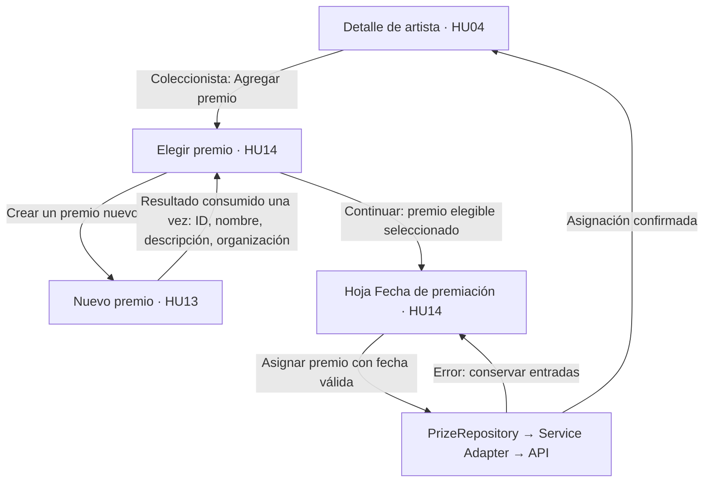
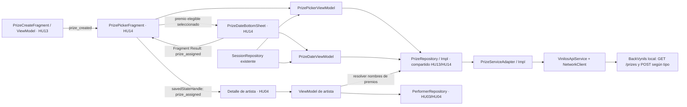

# 12. HU14 · Diseño técnico de la asignación de premios

Tarea: [HU14-01 · #115](https://github.com/misw-is-aplicaciones-moviles/MobileVynils/issues/115).
Responsable: @ManfredAriel91122. Sprint 2. Fecha de revisión: 03/11/2026.
Base: `develop` en `b5152a3932b55a2e3d08ac50ce20a4a506c6bd1f`.
Estado: diseño técnico y revisión visual completados para revisión e integración. Decisión del responsable: fecha obligatoria, respetando el backend local; no implementar Omitir.

## 1. Alcance y fuentes

Como coleccionista quiero agregar un premio a un artista para actualizar su información.
Incluye músicos y bandas: buscar y elegir un premio existente, abrir la hoja, seleccionar una fecha obligatoria, asignarlo y volver al detalle actualizado. Por decisión del responsable, prevalece el contrato del backend local frente a la fecha opcional dibujada en el mockup.
HU13 crea el premio; HU14 lo consulta, selecciona y asigna. El visitante puede consultar el detalle de HU04, pero no acceder a las acciones de asignación.

Fuentes revisadas:

- [HU14 en Wiki](https://github.com/misw-is-aplicaciones-moviles/MobileVynils/wiki/HU14) y [HU13](https://github.com/misw-is-aplicaciones-moviles/MobileVynils/wiki/HU13), copia de Wiki en `3ecb818`.
- [Arquitectura](02-arquitectura.md), [interfaz](05-reglas-de-diseno-ui.md), [pruebas](06-pruebas.md) y [diseño general](10-diseno-de-la-aplicacion.md).
- Código local de BackVynils en `7178f83662022904dc9e88b8a2292568954b56cf`: `src/prize/`, `src/performerprize/`, servicios de músicos/bandas e interceptor de errores. Colección `PerformerPrize Tests.postman_collection.json` como apoyo; prevalece el código ante diferencias de la colección.
- Consultas de solo lectura a `http://localhost:3000/prizes`, `/musicians` y `/bands`: HTTP 200. No se ejecutaron POST para elaborar este diseño.

Se inspeccionaron las exportaciones PNG de [Vynils V2 MockUps](https://www.figma.com/design/6N3ku4BZTPvXnxYUsgtdYx/Vynils-V2-MockUps?node-id=1-18), disponibles localmente en `/home/kausaustralis/Descargas/Vynils V2 MockUps`. La ruta es una referencia del entorno de revisión; el archivo compartido de Figma es la fuente para el equipo.

| Exportación revisada | Comportamiento observado |
|---|---|
| `HU14 · 1 Elegir premio.png` (390 × 844) | Pantalla completa con X y rol Coleccionista, búsqueda «Buscar premio», contexto «para [artista]», filas con nombre/organización, etiqueta «YA ASIGNADO», acceso «Crear un premio nuevo» y botón inferior deshabilitado «Selecciona un premio». No muestra barra inferior de pestañas. |
| `HU13 · 4 Premio creado.png` (390 × 844) | Nuevo premio seleccionado y resaltado, aviso «Premio creado» y botón «Continuar con «[premio]»». Conserva búsqueda y premios ya asignados. |
| `HU14 · 5 Fecha de premiación.png` (390 × 844) | Hoja inferior sobre el selector oscurecido; X, contexto premio/artista, «FECHA (OPCIONAL)», calendario, «Omitir» y «Asignar premio». Explica que Omitir asigna el premio dejando la fecha vacía. |
| `HU14 · 6 Premio asignado.png` (390 × 1000) | Regreso al detalle del músico con sección «PREMIOS · N», nombre, organización y fecha, nueva fila resaltada, snackbar «Premio asignado al artista» y pestaña Artistas activa. |

Las dimensiones de los PNG son referencia del lienzo, no alturas fijas de pantalla ni medidas que se deban copiar en píxeles. Reutilizar los tokens del kit y permitir desplazamiento. Los estados de red y errores que no dibujan estos frames se especifican como decisiones técnicas de robustez.

No incluye crear premios, eliminar o editar asignaciones, búsquedas remotas, nuevas dependencias, una nueva capa HTTP ni nuevas tablas/migraciones. La persistencia obligatoria del catálogo de álbumes sigue intacta; este flujo no promete disponibilidad offline.

## 2. Reutilización y responsabilidades

| Elemento | Uso y cambio mínimo |
|---|---|
| `NetworkClient`, `VinilosApiService`, `networkRequest`, `DataError` y `DataResult` | Añadir contratos a la interfaz Retrofit; conservar cliente, clasificación de errores y cancelación. |
| Proveedor de servicio y dispatchers del Service Adapter | Resolver el servicio y hacer E/S en IO; mapear en Default, como en álbumes. |
| `AppContainer` | Una instancia compartida de `PrizeRepository` y su Adapter para HU13/HU14. |
| Modelos/Repository de artistas de HU03/HU04 | Reutilizar `PerformerType` e identificadores; añadir solo el contrato necesario para premios y actualizar el detalle. No crearlos por segunda vez en HU14. |
| `SessionRepository`, `Event`, LiveData y factories | Rol, estado, eventos de navegación y dependencias por constructor. |
| `savedStateHandle` de Navigation y Fragment Result | HU13 devuelve el premio creado como resultado de pantalla completa; la hoja de fecha devuelve la asignación al selector con Fragment Result, como HU08. |
| Cabecera, `PaperSheetLayout`, estados, estilos y recursos | Componer las pantallas conservando el diseño del proyecto. |
| `MaterialDatePicker` de HU07 y `TrackCreateBottomSheet` de HU08 | Reutilizar calendario e interpretación UTC, y el patrón de hoja inferior con cierre, scrim y Fragment Result. No copiar formularios completos. |
| Selectores existentes al iniciar HU14-03 | Reutilizar el layout/Adapter si ya existen. `PickerAdapter` y `fragment_picker.xml` están previstos, pero no implementados en esta base; evitar una infraestructura genérica antes de tener un uso real. |
| Reglas JUnit, fakes, MockWebServer y Robots | Extender la infraestructura existente en HU14-04/05/06. |

HU04, HU13 y los componentes de artistas aún no están integrados en esta base. Los nombres de clases propuestos se adoptan o ajustan al contrato compartido antes de implementar, manteniendo una única definición de cada modelo.

## 3. Flujo y entregas de integración



1. HU04 expone la acción solo para Coleccionista y entrega `performerId` y `performerType`.
2. HU14 carga el catálogo y permite búsqueda local por nombre y selección única. Los premios ya asignados al artista llevan «YA ASIGNADO» y no son elegibles. Sin selección no se puede continuar.
3. Hito A de HU14-03: entregar este selector y su contrato de resultado para desbloquear HU13; no hace falta terminar la asignación para integrar la creación.
4. HU13 vuelve al selector con el premio guardado, seleccionado, y el aviso «Premio creado». No asigna todavía ni navega directamente a la fecha.
5. El botón «Continuar con «[premio]»» abre la hoja inferior de fecha. «Asignar premio» requiere y envía el día seleccionado; permanece deshabilitado mientras no haya fecha. No se muestra Omitir ni se permite enviar sin fecha. X/Atrás de la hoja la cierra y conserva el selector.
6. Tras éxito, cerrar la hoja y regresar al detalle original retirando el selector del back stack. Mostrar «Premio asignado al artista», actualizar el contador y resaltar la nueva fila una vez. Cancelar con X/Atrás sin enviar no escribe datos.

El flujo con premios existentes no depende de terminar HU13. El recorrido «crear y luego asignar» sí requiere su integración. No usar accesos de depuración para suplir HU04.

## 4. Contrato HTTP contrastado

| Operación | Petición | Respuesta de éxito |
|---|---|---|
| Listar premios | `GET /prizes`, sin cuerpo | 200, lista con `id`, `name`, `description`, `organization` y `performerPrizes[]`. `[]` es un estado vacío válido. |
| Asignar a músico | `POST /prizes/{prizeId}/musicians/{performerId}` | 200, asignación con `id`, `premiationDate`, `prize` y `performer`. |
| Asignar a banda | `POST /prizes/{prizeId}/bands/{performerId}` | Mismo contrato de asignación. |

El cuerpo del POST contiene únicamente:

```json
{"premiationDate":"2026-11-03T00:00:00.000Z"}
```

Fecha de ejemplo, no valor fijo para producción. Representar el día con `LocalDate` y enviar medianoche UTC, como `NewAlbum.toRequest()`. Interpretar el calendario y las respuestas en UTC para conservar el día seleccionado en GMT-5.

Reglas y límites verificados en el código:

- Premio o artista inexistente: 404. Fecha de tipo inválido o campos adicionales rechazados por Joi: 400. Fallos no clasificados por el backend: 500.
- El esquema usa `Joi.date()` sin `.required()`, pero la columna `performer_prize.premiationDate` es `NOT NULL`. Se comprobó en `information_schema.columns` de PostgreSQL local, además del decorador `@Column()` del código. La validación de entrada opcional no garantiza que omitir la fecha pueda guardarse; no prometer un 400 específico ni un éxito al omitir.
- No se comprobó una restricción de fecha futura o anterior al nacimiento/creación: no introducirla sin requisito explícito.
- Ambas rutas resuelven el artista a través de la tabla común `Performer`. La app debe elegir la ruta con el tipo de navegación; no confiar en que el servidor rechace un tipo equivocado.
- El servicio siempre crea una nueva asignación y no implementa idempotencia ni detección de duplicados. El mockup sí representa «YA ASIGNADO» sin selector activo: HU14 impide otra selección de ese premio para el mismo artista. Es una regla de interfaz, no una garantía de unicidad del servidor; conservar asignaciones históricas duplicadas que ya existan.
- El Adapter valida cuerpo, campos obligatorios e IDs anidados contra la solicitud. Un 2xx con respuesta inválida es un fallo de serialización con resultado de escritura incierto, no garantía de que no se guardó.
- Se conserva `retryOnConnectionFailure(false)` del cliente. No hacer reintentos automáticos de POST.

Los dos POST se contrastaron con el controlador, servicio y colección del backend local; su ejecución real queda para las tareas de implementación y pruebas, con datos preparados para ello.

### Decisión acordada: fecha obligatoria

El responsable indicó que prevalece el backend: la fecha debe exigirse también en la app. Esta decisión resuelve la incompatibilidad con el mockup sin cambiar el servicio ni el esquema de PostgreSQL.

- Sustituir la etiqueta «FECHA (OPCIONAL)» del mockup por «FECHA (OBLIGATORIA)» y retirar Omitir y su texto de ayuda.
- Mantener Asignar premio deshabilitado hasta elegir una fecha y validar también esa precondición en el ViewModel.
- El campo del UiState puede estar vacío durante la edición. El contrato de dominio/Repository exige `LocalDate` no nulo y el POST siempre incluye `premiationDate`.
- X/Atrás cancela o cierra la hoja sin asignar. No inventar una fecha ni autocompletar hoy para satisfacer el backend.
- La representación de una asignación confirmada incluye la fecha seleccionada. El backend conserva su contrato actual.

La tabla de exportaciones de la sección 1 registra lo observado en los PNG; esta sección define la desviación aprobada que debe implementar HU14-03.

## 5. Modelos y contratos compartidos propuestos

```kotlin
// models/: una única definición compartida con HU13.
data class Prize(
    val id: Int,
    val name: String,
    val description: String,
    val organization: String,
    val assignments: List<PrizeAssignmentRef> = emptyList(),
)
data class PrizeAssignmentRef(val id: Int, val premiationDate: LocalDate)
data class ArtistPrize(val id: Int, val prize: Prize, val premiationDate: LocalDate)

// Reutilizar PerformerType de HU03/HU04: MUSICIAN / BAND.
interface PrizeRepository {
    suspend fun getPrizes(forceRefresh: Boolean = false): DataResult<List<Prize>, DataError>
    suspend fun getArtistPrizes(
        assignments: List<PrizeAssignmentRef>,
        forceRefresh: Boolean = false,
    ): DataResult<List<ArtistPrize>, DataError>
    suspend fun assignPrize(
        performerId: Int,
        performerType: PerformerType,
        prizeId: Int,
        premiationDate: LocalDate,
    ): DataResult<ArtistPrize, DataError>
    // HU13 añadirá createPrize(draft: NewPrize); no crear otro Repository.
}
```

La fecha de dominio y del contrato de asignación es no anulable. El UiState admite ausencia de selección mientras el usuario completa la hoja, pero debe validar y obtener una fecha antes de invocar el Repository. Una fecha ausente o inválida en una respuesta se trata como error de serialización.

`PrizeDto`, `PrizeAssignmentRefDto`, `PrizeAssignmentDto` y `PrizeAssignmentRequest` permanecen en `network/dto/`. El último tiene únicamente `premiationDate`, obligatorio y no nulo en cada envío. Los campos DTO son anulables y se validan en los mappers, como en álbumes; los DTO no llegan a la UI. La lista de referencias vacía es válida; los campos obligatorios inválidos de un premio no se sustituyen por datos inventados.

`PrizeServiceAdapter`/`PrizeServiceAdapterImpl` expone las mismas operaciones remotas, devuelve dominio y lanza excepciones que `PrizeRepositoryImpl` traduce con `networkRequest`. Los IDs deben ser positivos antes de tocar la red. La cancelación se propaga.

`forceRefresh` omite cualquier lista retenida y revalida HTTP con `Cache-Control: no-cache`, como la consulta forzada del detalle de álbum. Acordar con HU04 la misma revalidación del detalle para comprobar escrituras inciertas; una respuesta antigua de caché no sirve para reconciliar un POST.

HU13 utiliza el mismo modelo de premio para devolver el registro creado. `assignments` puede estar vacío en esa respuesta; HU13 no necesita conocer la lógica de asignación.

### Relacionar premios con el detalle sin N peticiones

Las respuestas locales confirman que `performerPrizes[]` de músicos/bandas trae ID de asignación y fecha, pero no el nombre del premio. `GET /prizes` trae, para cada premio, esas referencias de asignación.

El detalle puede resolver sus nombres cruzando **ID de asignación** entre las referencias del artista y las del catálogo. No confundir ese ID con `prize.id` ni asumir que ambos coinciden; la semilla puede ocultar ese error. Mantener fecha y asignaciones históricas repetidas por ID de asignación. Para el selector, marcar un premio como ya asignado únicamente si alguna de sus referencias pertenece al artista actual; que otro artista lo tenga no lo bloquea.

Si el artista no tiene referencias, mostrar la sección vacía sin pedir el catálogo para esa unión. Si tiene referencias, obtener el catálogo una vez, compartido con el selector en la sesión cuando corresponda; no consultar `GET /prizes/{id}` por cada fila. Si la resolución falla, conservar el detalle y ofrecer reintento de la sección; no mostrar «sin premios» como si la carga hubiese sido correcta.

Tras un POST confirmado, la respuesta proporciona el premio y la fecha: actualizar el detalle con ese resultado por ID de asignación e invalidar cualquier catálogo retenido. En una nueva carga se vuelven a resolver las referencias. Si el refresco falla, conservar la asignación confirmada y distinguir el aviso de actualización de un fallo de guardado. No agregar tablas para este flujo.

## 6. Navegación, resultados y conservación de estado

Destinos de pantalla completa propuestos: `prizePickerFragment` (HU14) y `prizeCreateFragment` (HU13). La fecha es `PrizeDateBottomSheet`, un `BottomSheetDialogFragment` hijo del selector, siguiendo el patrón HU08; no es otra pantalla completa. El artista se identifica con `performerId: Int` y `performerType` validado. La hoja recibe también `prizeId`, nombre del premio y del artista; no pasar DTO ni objetos de dominio completos.

| Resultado | Emisor → receptor | Datos primitivos en `Bundle` de `savedStateHandle` |
|---|---|---|
| `prize_created` | HU13 → entrada anterior del selector | `prizeId`, `name`, `description`, `organization`. |
| `prize_assigned` | Hoja → selector mediante Fragment Result; selector → entrada original del detalle mediante savedStateHandle | `assignmentId`, `performerId`, `performerType`, `prizeId`, `name`, `description`, `organization`, `premiationDate` ISO obligatorio. |

Los resultados de Navigation se eliminan al consumirse, siguiendo HU07. El selector registra un listener en `childFragmentManager`; la hoja emite su resultado en `parentFragmentManager` y se cierra, como HU08. El receptor valida IDs/tipo y evita reprocesar el mismo ID de asignación, para no repetir selección, snackbar o guardado al recrear. HU13 coloca el resultado y hace `popBackStack()`. Tras asignar, el selector entrega el resultado al detalle original y hace `popBackStack()` hasta él; no crea un segundo detalle.

Usar `SavedStateHandle` para artista, tipo, búsqueda, premio seleccionado y fecha. Cerrar la hoja conserva la selección. Filtrar no cambia el artista ni borra la selección válida; X de la pantalla abandona el selector sin POST. Cancelar HU13 no cambia la selección previa. El resultado de HU13 inserta o actualiza el premio por ID antes de seleccionarlo; un refresco posterior no debe borrar ese registro nuevo por una respuesta anterior a su creación. El premio creado debe quedar visible aunque no coincida con la búsqueda anterior: limpiar el filtro al consumir ese resultado.

No persistir un estado «enviando» como orden de repetir el POST tras muerte del proceso. Restaurar las entradas y comprobar el resultado incierto antes de ofrecer otro envío. El cambio de rol limpia el flujo y usa la navegación al selector de rol existente; la acción de enviar valida nuevamente Coleccionista.

## 7. Estado y validación de interfaz

Una pareja de ViewModel/UiState para el selector y otra para la hoja, con LiveData inmutable y eventos de una sola vez, como en HU08. Evitar un ViewModel global para todo el proyecto. Las acciones de negocio van al Repository; el Fragment solo representa estado, coordina resultados y navega.

| Pantalla/estado | Comportamiento propuesto |
|---|---|
| Selector cargando | Estado compartido de carga; Continuar deshabilitado. |
| Catálogo con datos | Nombre y organización, icono de premio, búsqueda local por nombre, selección única por prizeId y fila resaltada; premios del artista ya asignados sin radio activo y con «YA ASIGNADO». Mantener el orden recibido; el frame no impone orden alfabético. |
| Sin selección / con selección | Botón inferior «Selecciona un premio» deshabilitado; al elegir, «Continuar con «[premio]»» habilitado. Crear premio permanece disponible. |
| Búsqueda sin coincidencias | No confundir con catálogo vacío; permitir limpiar búsqueda y acceder a Crear un premio nuevo. No añadir endpoint ni búsqueda remota. |
| Catálogo vacío | Mensaje informativo; acceso a crear premio de HU13; sin selección ficticia. |
| Error de consulta | Estado compartido de error y Reintentar, sin confundirlo con vacío. Si había lista válida, conservarla y avisar del fallo de actualización. |
| Hoja de fecha | Contexto premio/artista, X, título «Fecha de premiación», etiqueta «FECHA (OBLIGATORIA)», campo con calendario y acción «Asignar premio». Reutilizar estilo de hoja y scrim de HU08. Sin Omitir ni ayuda que prometa asignación sin fecha. |
| Fecha sin elegir | Asignar premio deshabilitado. Si se solicita el envío desde la lógica sin fecha, mostrar la validación obligatoria y no llamar al Repository. No sustituir por hoy ni por otra fecha predeterminada. |
| Fecha elegida | Mostrar dd / MM / yyyy; Asignar premio envía el día con IDs válidos, premio elegible y rol Coleccionista. El día dibujado es un ejemplo, no un valor predeterminado fijo. |
| Enviando | Una solicitud en curso, bloqueo de doble toque y controles que iniciarían otra escritura; no perder selección/fecha. |
| Error de envío | Conservar entradas; distinguir 404, 400, servidor, red y respuesta inválida mediante `DataError` y recursos. |
| Éxito | Regresar al detalle, incrementar PREMIOS · N, mostrar nombre/organización/fecha, resaltar nueva fila y mostrar «Premio asignado al artista» una vez, con Artistas activa. |
| Visitante/argumentos inválidos | Sin acciones de asignación ni peticiones inválidas; salida segura al detalle/selector. |

Textos nuevos en `strings.xml`, medidas en `dimens.xml`, colores/estilos existentes, objetivos táctiles de 48 dp y descripciones accesibles. Mantener X y rol en la cabecera del selector, ayuda «¿No está en la lista? Regístralo y asígnalo.» y acceso «Crear un premio nuevo». No añadir filtros por organización, búsqueda remota ni reglas adicionales de fechas. Toda asignación nueva debe mostrar la fecha elegida en el detalle; no se implementa un estado exitoso sin fecha.

### Reintento y resultado incierto

Evitar doble toque no garantiza idempotencia del servidor. Tras timeout, desconexión, 500 o un 2xx no interpretable, el backend podría haber guardado la asignación. Conservar selección/fecha e intentar revalidar el detalle y el catálogo antes de habilitar otro POST. Comparar artista, premio y día utilizando las referencias y los IDs de asignación anteriores al envío: una coincidencia que ya existía antes no confirma una nueva escritura. No borrar asignaciones previas. Si no se puede determinar el resultado, informar la incertidumbre y permitir revalidar; no repetir automáticamente la escritura. No anunciar éxito sin una asignación confirmada. Esta protección y sus límites deben verificarse en HU14-04/06.

## 8. Diagrama de componentes y datos



Las flechas hacia Repository representan llamadas del ViewModel; la respuesta vuelve como `DataResult`, se transforma en UiState y la Vista observa LiveData. `AppContainer` construye las instancias; no se llama Retrofit desde Fragments o ViewModels.

## 9. Entregables y comprobaciones de esta tarea

- Documento de diseño, diagrama y contratos HU04/HU13/HU14.
- Inventario inicial CP-HU14 en `06-pruebas.md`; todos los casos nuevos permanecen propuestos, sin ejecución declarada.
- Aclaración del alcance Sprint 2 en `10-diseno-de-la-aplicacion.md` y enlace desde el índice.
- GET locales y esquema de la fecha verificados; fuentes del POST revisadas; sin escrituras, pruebas instrumentadas ni cambios en la aplicación durante HU14-01.
- Revisión visual completada con los tres frames de HU14 y el retorno HU13. Búsqueda, premios ya asignados, hoja inferior y mensajes están contrastados. La única desviación funcional acordada es exigir fecha y retirar Omitir.
- Decisión de fecha resuelta por el responsable: la app exige el dato y no cambia el backend. El diseño queda listo para revisión e integración; revisar el contrato compartido con HU13 al implementarlo.

No cerrar #115 ni moverlo a Done antes de integrar el diseño conforme al flujo del repositorio. Los siguientes pasos de código corresponden a HU14-02 y HU14-03.

## 10. Implementación de datos HU14-02

La rama `feature/HU14-02-datos` implementa el catálogo y ambas rutas de asignación con fecha obligatoria, DTO validados, mapeo a dominio y clasificación de errores mediante `networkRequest`. `AppContainer.prizeRepository` comparte el cliente de red existente; no se incorporan librerías, tablas ni migraciones.

`PrizeRepository.getArtistPrizes` resuelve las referencias del artista con una consulta de catálogo, sin N peticiones. Con referencias vacías no consulta la red; las referencias no resueltas, duplicadas en el catálogo o con fecha inconsistente se consideran errores de serialización, en vez de presentar falsamente una sección vacía. Las asignaciones históricas del mismo premio se conservan por su ID propio.

No hay una segunda caché del catálogo de premios en memoria o Room. `forceRefresh=true` fuerza revalidación HTTP; el flujo de interfaz deberá utilizarlo al reconciliar una escritura o recargar después de HU13. `assignPrize` devuelve `ArtistPrize` para actualizar el detalle, valida los IDs solicitados y comprueba que artista, premio y día de la respuesta coincidan. No reintenta automáticamente el POST ni interpreta un 2xx sin cuerpo válido como éxito confirmado.

Se añade una única definición `PerformerType` con `MUSICIAN`/`BAND`, compartida con la implementación futura de HU03/HU04. HU13 debe ampliar este mismo `PrizeRepository` y `PrizeServiceAdapter` para crear premios; no implementar otro cliente o repositorio paralelo.

Esta tarea no implementa pantallas, selección, roles, revalidación de escrituras inciertas desde el ViewModel ni integración visual con HU04/HU13: corresponde a HU14-03. Sus pruebas iniciales de contrato HTTP y Repository están en `PrizeRepositoryImplTest` y usan `MockWebServerRule`, el cliente Retrofit/OkHttp real y datos sintéticos reproducibles con IDs de premio y asignación diferentes. HU14-04/06 ampliarán esa cobertura sin duplicarla.

Validación del 03/11/2026: Spotless, detekt, Lint debug y `testDebugUnitTest` en verde. 16 pruebas nuevas de HU14 aprobadas, 148 JVM en total, sin fallos, errores u omisiones. No se ejecutaron pruebas de interfaz ni POST contra BackVynils en esta tarea; los POST del contrato se comprobaron en MockWebServer local.
