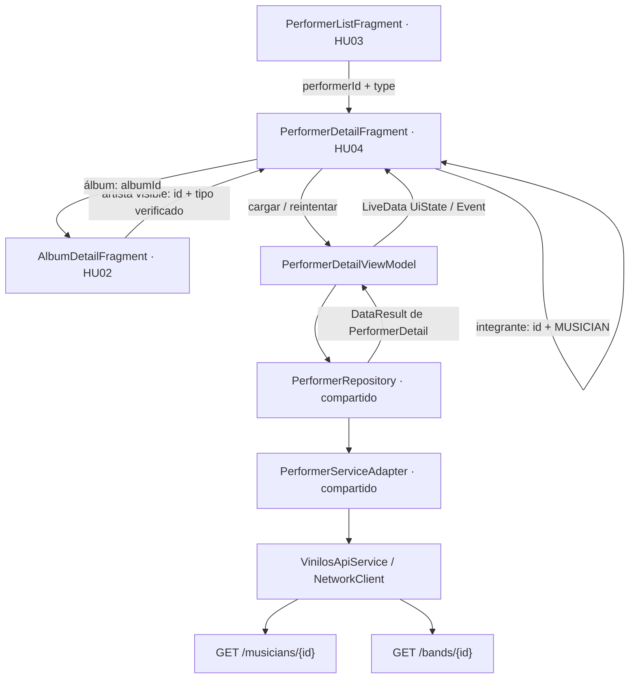
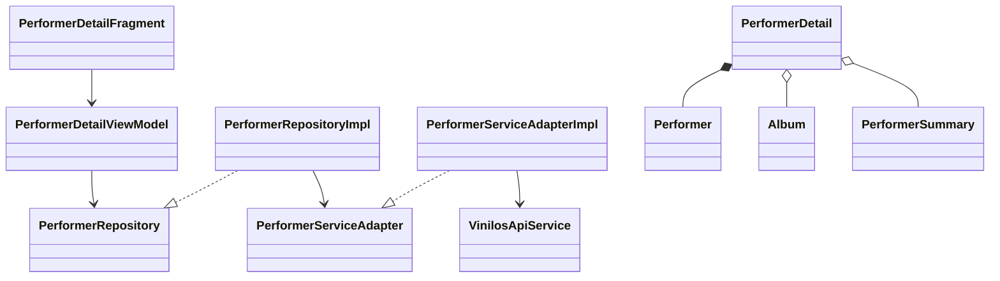

# 13. HU04 · Diseño técnico del detalle de artista

Estado: propuesta de diseño de HU04-01; implementación y pruebas pendientes.
Tarea: [HU04-01 · #37](https://github.com/misw-is-aplicaciones-moviles/MobileVynils/issues/37).
Responsable: @ManfredAriel91122. Fecha: 04/11/2026.
Base: `develop` local, `b5152a3`. Rama principal: `feature/HU04-detalle-artista`.
Referencia compartida: HU03, PR #121, revisado en `abc41bd`; incorporado a nuestra principal como base local de trabajo, con su revisión y correcciones pendientes.
Referencia de premios: ramas locales HU14-02 (`b0592c8`) y HU14-03 (`20004fb`).

## 1. Alcance

Como usuario visitante quiero ver el detalle de un artista para ampliar la información sobre él.
La misma consulta está disponible para Coleccionista.

Un único destino representa músico o banda. Muestra imagen, nombre, descripción, nacimiento o creación y álbumes; la banda muestra además sus integrantes. Permite abrir el detalle de un álbum y el de un integrante, volver al origen y conservar el rol y el estado de pantalla durante una recreación. Incluye carga, recurso inexistente, error, reintento y secciones vacías.

HU03 aporta la lista y su identidad tipada. HU04 no implementa otra lista de artistas. Agregar integrantes corresponde a HU12, crear premios a HU13 y agregar álbumes a HU15. No se añaden controles sin una acción real, dependencias, accesos de depuración ni modificaciones al backend.

Los premios de los wireframes se completarán al retomar HU14: consulta de la sección mediante su repositorio existente, acceso de Coleccionista al selector y actualización tras asignar. HU04 aporta el detalle receptor; no reimplementa el catálogo, la selección, la fecha ni el POST de premios. Esta integración tendrá evidencia propia antes de declarar completo ese recorrido.

Referencias locales: [arquitectura](02-arquitectura.md), [interfaz](05-reglas-de-diseno-ui.md), [pruebas](06-pruebas.md) y [diseño general](10-diseno-de-la-aplicacion.md).

## 2. Wireframes contrastados

Exportación revisada: `Vynils V2 MockUps`, disponible localmente en Descargas.

| Frame | Uso en el diseño |
|---|---|
| `HU04 · Músico.png` | Cabecera Músico, disco con fotografía central, nacimiento, nombre, descripción y filas de álbumes con portada, nombre, año y navegación. Sección Premios preparada para integrar HU14. |
| `HU04 · Banda.png` | Cabecera Banda, fecha de creación, descripción, integrantes con imagen/nombre y álbumes. Contadores derivados de las colecciones recibidas. |
| `Visitante · Banda.png` | Mismo contenido de consulta; sin acciones de escritura. |
| `HU14 · 6 Premio asignado.png` | Referencia posterior de integración: fila de premio, contador y confirmación al regresar del selector. No acredita una implementación en HU04-01. |

Se reutilizan cabecera, fondo de papel, recursos del disco y estilos del proyecto; solo se agregan layouts/medidas específicos del detalle. Una superficie vertical desplazable contiene el detalle completo. Secciones y filas soportan texto largo y lista extensa; no se toman los nombres, cantidades ni integrantes dibujados como datos de producción o de prueba. La imagen inaccesible utiliza un marcador existente.

La fotografía de artista usa el disco circular del listado HU03 y Glide. Las filas de álbum reutilizan `VinylArtworkView` y los recursos del catálogo cuando encajen con el frame; no se fuerza el layout completo del catálogo si contiene textos que este detalle no solicita.

## 3. Reutilización y dependencias

| Componente | Estado en la base revisada | Uso o ampliación mínima |
|---|---|---|
| `Performer`, `PerformerType` | Definidos en HU03; pendientes en develop | Reutilizar las mismas clases, nombres y rutas. No crear modelos paralelos de músico/banda. |
| `PerformerRepository` y `PerformerServiceAdapter` | Definidos en HU03 | Añadir consulta de detalle por ID/tipo; conservar contratos y comportamiento del listado. |
| `MusicianDto`, `BandDto` y sus mappers | Definidos en HU03 | Ampliar los DTO existentes para descripción y relaciones completas; mantener los mappers de lista. |
| `PerformerSummary`, `Album` y `AlbumDto` | Existentes en develop | Reutilizar resúmenes de integrantes y datos de álbumes; conservar los campos opcionales compatibles con HU02. |
| `VinilosApiService`, `NetworkClient`, `networkRequest`, `AppContainer` | Existentes | Añadir endpoints y entrega de dependencias sin otro cliente HTTP. |
| `SessionRepository`, `Event`, factories y LiveData | Existentes | Compartir rol, estado y navegación de un solo consumo. |
| `view_header`, `PaperSheetLayout`, estados, Glide y recursos de disco | Existentes; disco de artista en HU03 | Componer el detalle sin alterar el tema global ni el comportamiento de HU02. |
| Reglas JVM, fakes, MockWebServer, ViewWaits y Robots | Existentes; apoyos de artistas en HU03 | Ampliar lo necesario, sin duplicar utilidades. |

Por decisión del responsable del 04/11/2026, se incorpora la copia local de HU03 (`abc41bd`) a `feature/HU04-detalle-artista` para continuar HU04-02, conservando intacta la rama de Yoimar. El PR #121 sigue pendiente de aprobación y de las correcciones solicitadas sobre pruebas dependientes de conteos de semilla y descripción/título del PR. Cuando su versión corregida se integre en develop, se reconciliarán esos cambios con nuestra principal y se repetirán los controles; la integración local no declara aceptado el PR ni resueltas sus observaciones. No se duplican las clases compartidas.

## 4. Componentes y flujo



El Fragment dibuja el estado, conserva/restaura la posición con RecyclerView y ejecuta eventos de navegación. El ViewModel no conoce vistas ni DTO; el Repository usa `networkRequest` como frontera de errores. El adaptador conserva proveedor del servicio, dispatcher IO y dispatcher Default del proyecto; la inicialización HTTP que toca disco sigue fuera del hilo principal.



Paquetes: `ui/artists` para Fragment/adaptador de filas, `viewmodels` para UiState/Event/ViewModel, `repositories` para el contrato compartido, `network/dto` para DTO/mappers y `models` para dominio Kotlin puro. No se crea otro módulo ni una capa adicional.

## 5. Contrato de datos propuesto

### Modelo de detalle por composición

HU03 usa `Performer` como resumen con tipo, fecha y contadores. Se conserva esa clase y se compone con los datos completos, evitando repetir sus campos o cambiar la semántica de su caché de lista:

```kotlin
// models/PerformerDetail.kt · propuesto para HU04-02
// Performer y PerformerType son los de HU03.
data class PerformerDetail(
    val performer: Performer,
    val description: String,
    val albums: List<Album>,
    val members: List<PerformerSummary>,
)

// En PerformerRepository y PerformerServiceAdapter existentes:
suspend fun getPerformer(
    id: Int,
    type: PerformerType,
    forceRefresh: Boolean = false,
): DataResult<PerformerDetail, DataError> // Repository.

// En PerformerServiceAdapter: mismo nombre y parámetros, distinto retorno.
suspend fun getPerformer(
    id: Int,
    type: PerformerType,
    forceRefresh: Boolean = false,
): PerformerDetail
```

Los contadores del `Performer` del detalle se calculan desde sus colecciones: álbumes recibidos y miembros recibidos, no desde un resumen antiguo de Room. Para músico, `members` está vacío. `bandId/bandName` del resumen no se inventan: el endpoint de músico no carga esa relación y HU04 no la necesita para dibujar este frame.

Ampliar `MusicianDto`/`BandDto` con `description`; sus álbumes deben contener los datos de `AlbumDto`, y los integrantes de banda los campos necesarios para `PerformerSummary`. Los mappers del listado continuarán contando relaciones por su tamaño e ID, sin exigir los datos completos de una fila de detalle. Se ajustarán sus fixtures mínimos y conservarán sus pruebas existentes.

### API real y validación

| Tipo | Petición | Datos del detalle |
|---|---|---|
| MUSICIAN | `GET /musicians/{id}` | id, name, image, description, birthDate, albums; además llegan performerPrizes para integrar HU14. |
| BAND | `GET /bands/{id}` | id, name, image, description, creationDate, albums, musicians; además performerPrizes. |

Contrato contrastado con el código del BackVynils local: `musician.service.ts` carga albums/performerPrizes; `band.service.ts` carga albums/musicians/performerPrizes. No se requieren llamadas por cada álbum o integrante, ni consultar ambas listas para obtener un detalle cuyo tipo ya se conoce.

- ID solicitado positivo; tipo de argumentos reconocido. Rechazar argumentos inválidos sin red y ofrecer salida segura.
- Comprobar que la respuesta coincide con ID/tipo solicitados y contiene nombre y fecha válida. Fechas ISO se convierten a `LocalDate` en UTC reutilizando `parseUtcDate` de HU03; no se desplaza el día por GMT-5.
- Validar los campos de las filas completas que se dibujan. Colecciones vacías son válidas; elementos nulos o datos incoherentes se convierten en error de serialización, sin cierres por nulabilidad de Gson.
- HTTP 404 produce estado de artista inexistente; HTTP 500 produce error de servidor; desconexión y timeout se clasifican como Network; JSON inválido se clasifica como Serialization. Se conserva la cancelación de corrutinas.
- El reintento solicita revalidación HTTP (`Cache-Control: no-cache`) para el detalle. No introduce reintentos automáticos ni nuevas llamadas al cambiar de rol o recrear la vista con el mismo ViewModel.

### Caché

Propuesta mínima: detalle remoto, como HU02. La caché Room de artistas de HU03 conserva su esquema y su política de lista; HU04 no guarda un detalle parcial en ella, no migra a otra versión ni promete acceso offline al detalle. Se reutiliza la caché HTTP existente sin cambiar su política global. Esta decisión concreta acota la propuesta general de persistir listas y detalles de docs/10; si se solicita offline para el detalle, requiere ampliar alcance y diseño antes de añadir relaciones a Room.

## 6. Navegación y estado

### Entradas y salidas

Destino existente en HU03: `performerDetailFragment`, con `performerId: Int` y `type: String` (`MUSICIAN`/`BAND`). HU04 sustituirá la clase provisional por `PerformerDetailFragment` y conservará el ID y las claves. La Factory leerá `SavedStateHandle`; no habrá objetos completos como argumentos.

Desde HU02, `PerformerSummary` todavía no conserva el tipo. Ampliarlo con `type: PerformerType? = null` y su DTO/mapper de forma compatible. La respuesta real de álbum incluye birthDate para músico o creationDate para banda: usar esas señales verificadas, sin asumir tipo por nombre, ID u orden. Si ambas señales están presentes o ninguna permite identificar el tipo, no habilitar una navegación a un endpoint adivinado. La ausencia de artista conserva el texto y comportamiento existentes de HU02. Esta adaptación tendrá pruebas de regresión propias en HU04-02/03.

Las filas de álbum abren `albumDetailFragment(albumId)` existente. Un integrante abre el mismo destino de HU04 con su ID y MUSICIAN, por ser miembro de la relación musicians. Evitar doble navegación al tocar rápidamente. Atrás de cabecera y Atrás del sistema vuelven a la entrada anterior sin recrear otra lista. La pestaña Artistas aparece activa mientras se consulta un artista; volver a tocarla regresa a la raíz de HU03. El chip de rol conserva la limpieza de sesión/pila del proyecto.

### UiState y ciclo de vida

Estado propuesto: identidad válida, rol, `detail: PerformerDetail?`, `isLoading` y `error: DataError?`. `canEdit` se deriva del rol para la integración posterior; HU04 solo realiza lecturas.

Eventos propuestos: abrir álbum, abrir integrante, volver al selector de rol y salida segura por argumentos inválidos. Un único ViewModel carga el destino y bloquea solicitudes concurrentes; el Fragment no realiza red. RecyclerView usa `PREVENT_WHEN_EMPTY` y restaura su posición cuando llegan las filas. El rol sigue a SessionRepository y el proceso restaurado sin sesión sigue la navegación existente al selector.

| Estado | Resultado visible |
|---|---|
| Cargando | Cabecera y estado de carga compartido, sin contenido anterior de otro artista. |
| Contenido de músico | Foto/marcador, nombre, descripción, nacimiento y álbumes. |
| Contenido de banda | Foto/marcador, nombre, creación, descripción, integrantes y álbumes. |
| Álbumes vacíos | Datos del artista conservados y mensaje específico de ausencia de álbumes. |
| Banda sin integrantes | Datos y álbumes conservados, contador 0 y mensaje de integrantes vacíos. |
| 404 | Artista inexistente con salida por Atrás y reintento. |
| Network / Http / Serialization | Mensaje de error apropiado y Reintentar, sin cierre inesperado. |
| Recreación | Mismo artista, rol, contenido y posición; no se repite una solicitud completada solo por recrear la vista. |

Todo texto visible va en strings/plurals, colores y medidas en recursos. Acciones nuevas con área mínima de 48 dp y descripción accesible; imágenes decorativas no agregan nodos redundantes. Se marcan encabezados y el orden de lectura sigue al contenido. No se usa una altura rígida del detalle que oculte las últimas secciones.

## 7. Integración posterior con premios

La sección Premios de los frames no se descarta. Se completará en la rama de HU14 una vez incorporada la base de HU04, usando `PrizeRepository.getArtistPrizes` y `PrizeAssignmentRef` existentes allí; no se crearán DTO, modelo ni repositorio alternos para premios en HU04-01.

La entrada a HU14 usa sus claves propias: `performerId`, `performerType`, `performerName` y `assignmentIds`. No confundir `type` del destino HU04 con `performerType` del selector: el Fragment adapta las claves en la frontera, usando `PrizePickerFragment.argumentsFor`. Los IDs de assignmentIds son de asociación, no de premio.

En esa integración, `PerformerDetail` incorporará las referencias de asignación con el `PrizeAssignmentRef` ya definido en HU14, a partir de performerPrizes de la respuesta. No se creará otro tipo de premio o de asociación para HU04.

El detalle consumirá una vez `prize_assigned`, validará artista/tipo, actualizará fila y contador por ID de asociación y mostrará confirmación. `prizes_refresh_requested` exige revalidar detalle y catálogo de premios para comprobar una escritura incierta; no autoriza a repetir automáticamente el POST. El visitante verá la información, sin acción Agregar premio. HU13 solo se necesita para el recorrido adicional de crear un premio nuevo.

## 8. Pruebas y criterio de cierre

El [inventario](06-pruebas.md#hu04--detalle-de-artista) define CP-HU04-01 a CP-HU04-17 con nivel y estado pendientes. No sustituyen ni renumeran CP-HU03 o CP-HU14. La correspondencia con clases/métodos se completará cuando se implementen, sin marcar como aprobados casos todavía no ejecutados.

Reutilizar `MockWebServerRule`, `MainDispatcherRule`, fakes de sesión y repositorios, `TestResources`, `ViewWaits` y Robots. La preparación de artistas de HU03 se ampliará solo si hace falta. Usar datos propios identificables y valores contrastados con el backend; no posiciones fijas, nombres de semilla con conteos supuestos, limpieza indiscriminada ni esperas fijas. No usar el DELETE de asociaciones de premios del backend para limpiar fixtures.

HU04-01 entrega diseño, diagramas, contratos, reutilización, límites e inventario propuesto. No entrega Kotlin/XML ni requiere ejecutar Gradle por cambios exclusivos de documentación. HU04-02/03 implementan y hacen comprobaciones iniciales; HU04-04/05/06 amplían las pruebas sin duplicarlas. Los resultados se registrarán solo tras ejecutarse en JVM/tablet; API 21/37 y el flujo integrado de premios permanecerán pendientes mientras no haya evidencia.
