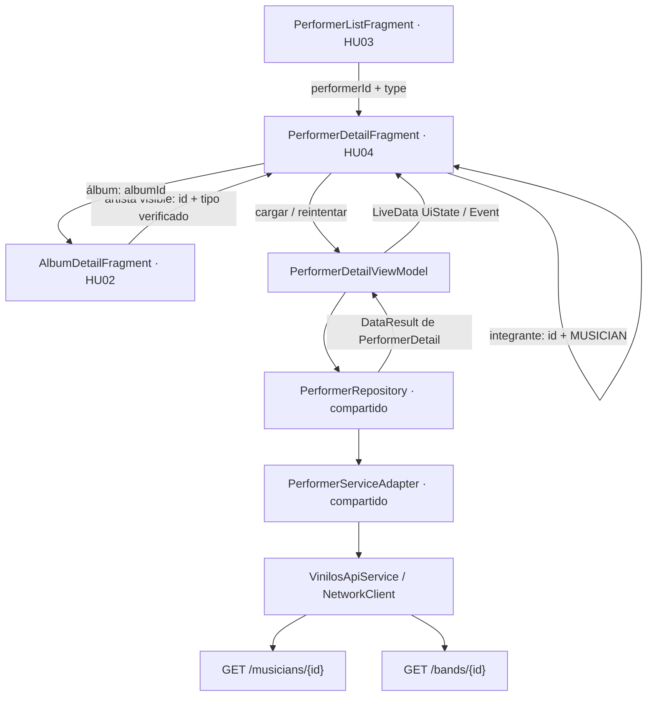
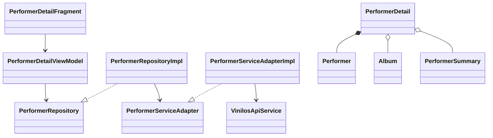

# 13. HU04 · Diseño técnico del detalle de artista

Estado: HU04-01 documentada; HU04-02 implementada (sección 9); HU04-03 con pantalla, ViewModel y navegación implementados y verificados inicialmente (sección 10). Integración de premios y ampliación de pruebas pendientes.
Tarea: [HU04-01 · #37](https://github.com/misw-is-aplicaciones-moviles/MobileVynils/issues/37).
Responsable: @ManfredAriel91122. Fecha: 04/11/2026.
Base: `develop` local, `b5152a3`. Rama principal: `feature/HU04-detalle-artista`.
Referencia compartida: HU03, PR #121, revisado en `abc41bd`; incorporado a nuestra principal como base local de trabajo, con su revisión y correcciones pendientes.
Referencia de premios: ramas locales HU14-02 (`b0592c8`) y HU14-03 (`20004fb`).

## 1. Alcance

Como usuario visitante quiero ver el detalle de un artista para ampliar la información sobre él.
La misma consulta está disponible para Coleccionista.

Un único destino representa músico o banda. Muestra imagen, nombre, descripción, nacimiento o creación y álbumes; la banda muestra además sus integrantes. Permite abrir el detalle de un álbum y el de un integrante, volver al origen y conservar el rol y el estado de pantalla durante una recreación. Incluye carga, recurso inexistente, error, reintento y secciones vacías.

HU03 aporta la lista y su identidad tipada. HU04 no implementa otra lista de artistas. Agregar integrantes corresponde a HU12, crear premios a HU13 y agregar álbumes a HU15. No se añaden controles sin una acción real, dependencias, accesos de depuración ni modificaciones al backend.

Los premios de los wireframes se completarán al retomar HU14: consulta de la sección mediante su repositorio existente, acceso de Coleccionista al selector y actualización tras asignar. HU04 aporta el detalle receptor; no reimplementa el catálogo, la selección, la fecha ni el POST de premios. Esta integración tendrá evidencia propia antes de declarar completo ese recorrido.

Referencias locales: [arquitectura](02-arquitectura.md), [interfaz](05-reglas-de-diseno-ui.md), [pruebas](06-pruebas.md) y [diseño general](10-diseno-de-la-aplicacion.md).

## 2. Wireframes contrastados

Exportación revisada: `Vynils V2 MockUps`, disponible localmente en Descargas.

| Frame | Uso en el diseño |
|---|---|
| `HU04 · Músico.png` | Cabecera Músico, disco con fotografía central, nacimiento, nombre, descripción y filas de álbumes con portada, nombre, año y navegación. Sección Premios preparada para integrar HU14. |
| `HU04 · Banda.png` | Cabecera Banda, fecha de creación, descripción, integrantes con imagen/nombre y álbumes. Contadores derivados de las colecciones recibidas. |
| `Visitante · Banda.png` | Mismo contenido de consulta; sin acciones de escritura. |
| `HU14 · 6 Premio asignado.png` | Referencia posterior de integración: fila de premio, contador y confirmación al regresar del selector. No acredita una implementación en HU04-01. |

Se reutilizan cabecera, fondo de papel, recursos del disco y estilos del proyecto; solo se agregan layouts/medidas específicos del detalle. Una superficie vertical desplazable contiene el detalle completo. Secciones y filas soportan texto largo y lista extensa; no se toman los nombres, cantidades ni integrantes dibujados como datos de producción o de prueba. La imagen inaccesible utiliza un marcador existente.

La fotografía de artista usa el disco circular del listado HU03 y Glide. Las filas de álbum reutilizan `VinylArtworkView` y los recursos del catálogo cuando encajen con el frame; no se fuerza el layout completo del catálogo si contiene textos que este detalle no solicita.

## 3. Reutilización y dependencias

| Componente | Estado en la base revisada | Uso o ampliación mínima |
|---|---|---|
| `Performer`, `PerformerType` | Definidos en HU03; pendientes en develop | Reutilizar las mismas clases, nombres y rutas. No crear modelos paralelos de músico/banda. |
| `PerformerRepository` y `PerformerServiceAdapter` | Definidos en HU03 | Añadir consulta de detalle por ID/tipo; conservar contratos y comportamiento del listado. |
| `MusicianDto`, `BandDto` y sus mappers | Definidos en HU03 | Ampliar los DTO existentes para descripción y relaciones completas; mantener los mappers de lista. |
| `PerformerSummary`, `Album` y `AlbumDto` | Existentes en develop | Reutilizar resúmenes de integrantes y datos de álbumes; conservar los campos opcionales compatibles con HU02. |
| `VinilosApiService`, `NetworkClient`, `networkRequest`, `AppContainer` | Existentes | Añadir endpoints y entrega de dependencias sin otro cliente HTTP. |
| `SessionRepository`, `Event`, factories y LiveData | Existentes | Compartir rol, estado y navegación de un solo consumo. |
| `view_header`, `PaperSheetLayout`, estados, Glide y recursos de disco | Existentes; disco de artista en HU03 | Componer el detalle sin alterar el tema global ni el comportamiento de HU02. |
| Reglas JVM, fakes, MockWebServer, ViewWaits y Robots | Existentes; apoyos de artistas en HU03 | Ampliar lo necesario, sin duplicar utilidades. |

Por decisión del responsable del 04/11/2026, se incorpora la copia local de HU03 (`abc41bd`) a `feature/HU04-detalle-artista` para continuar HU04-02, conservando intacta la rama de Yoimar. El PR #121 sigue pendiente de aprobación y de las correcciones solicitadas sobre pruebas dependientes de conteos de semilla y descripción/título del PR. Cuando su versión corregida se integre en develop, se reconciliarán esos cambios con nuestra principal y se repetirán los controles; la integración local no declara aceptado el PR ni resueltas sus observaciones. No se duplican las clases compartidas.

## 4. Componentes y flujo



El Fragment dibuja el estado, conserva/restaura la posición con RecyclerView y ejecuta eventos de navegación. El ViewModel no conoce vistas ni DTO; el Repository usa `networkRequest` como frontera de errores. El adaptador conserva proveedor del servicio, dispatcher IO y dispatcher Default del proyecto; la inicialización HTTP que toca disco sigue fuera del hilo principal.



Paquetes: `ui/artists` para Fragment/adaptador de filas, `viewmodels` para UiState/Event/ViewModel, `repositories` para el contrato compartido, `network/dto` para DTO/mappers y `models` para dominio Kotlin puro. No se crea otro módulo ni una capa adicional.

## 5. Contrato de datos propuesto

### Modelo de detalle por composición

HU03 usa `Performer` como resumen con tipo, fecha y contadores. Se conserva esa clase y se compone con los datos completos, evitando repetir sus campos o cambiar la semántica de su caché de lista:

```kotlin
// models/PerformerDetail.kt · propuesto para HU04-02
// Performer y PerformerType son los de HU03.
data class PerformerDetail(
    val performer: Performer,
    val description: String,
    val albums: List<Album>,
    val members: List<PerformerSummary>,
)

// En PerformerRepository y PerformerServiceAdapter existentes:
suspend fun getPerformer(
    id: Int,
    type: PerformerType,
    forceRefresh: Boolean = false,
): DataResult<PerformerDetail, DataError> // Repository.

// En PerformerServiceAdapter: mismo nombre y parámetros, distinto retorno.
suspend fun getPerformer(
    id: Int,
    type: PerformerType,
    forceRefresh: Boolean = false,
): PerformerDetail
```

Los contadores del `Performer` del detalle se calculan desde sus colecciones: álbumes recibidos y miembros recibidos, no desde un resumen antiguo de Room. Para músico, `members` está vacío. `bandId/bandName` del resumen no se inventan: el endpoint de músico no carga esa relación y HU04 no la necesita para dibujar este frame.

Ampliar `MusicianDto`/`BandDto` con `description`; sus álbumes deben contener los datos de `AlbumDto`, y los integrantes de banda los campos necesarios para `PerformerSummary`. Los mappers del listado continuarán contando relaciones por su tamaño e ID, sin exigir los datos completos de una fila de detalle. Se ajustarán sus fixtures mínimos y conservarán sus pruebas existentes.

### API real y validación

| Tipo | Petición | Datos del detalle |
|---|---|---|
| MUSICIAN | `GET /musicians/{id}` | id, name, image, description, birthDate, albums; además llegan performerPrizes para integrar HU14. |
| BAND | `GET /bands/{id}` | id, name, image, description, creationDate, albums, musicians; además performerPrizes. |

Contrato contrastado con el código del BackVynils local: `musician.service.ts` carga albums/performerPrizes; `band.service.ts` carga albums/musicians/performerPrizes. No se requieren llamadas por cada álbum o integrante, ni consultar ambas listas para obtener un detalle cuyo tipo ya se conoce.

- ID solicitado positivo; tipo de argumentos reconocido. Rechazar argumentos inválidos sin red y ofrecer salida segura.
- Comprobar que la respuesta coincide con ID/tipo solicitados y contiene nombre y fecha válida. Fechas ISO se convierten a `LocalDate` en UTC reutilizando `parseUtcDate` de HU03; no se desplaza el día por GMT-5.
- Validar los campos de las filas completas que se dibujan. Colecciones vacías son válidas; elementos nulos o datos incoherentes se convierten en error de serialización, sin cierres por nulabilidad de Gson.
- HTTP 404 produce estado de artista inexistente; HTTP 500 produce error de servidor; desconexión y timeout se clasifican como Network; JSON inválido se clasifica como Serialization. Se conserva la cancelación de corrutinas.
- El reintento solicita revalidación HTTP (`Cache-Control: no-cache`) para el detalle. No introduce reintentos automáticos ni nuevas llamadas al cambiar de rol o recrear la vista con el mismo ViewModel.

### Caché

Propuesta mínima: detalle remoto, como HU02. La caché Room de artistas de HU03 conserva su esquema y su política de lista; HU04 no guarda un detalle parcial en ella, no migra a otra versión ni promete acceso offline al detalle. Se reutiliza la caché HTTP existente sin cambiar su política global. Esta decisión concreta acota la propuesta general de persistir listas y detalles de docs/10; si se solicita offline para el detalle, requiere ampliar alcance y diseño antes de añadir relaciones a Room.

## 6. Navegación y estado

### Entradas y salidas

Destino existente en HU03: `performerDetailFragment`, con `performerId: Int` y `type: String` (`MUSICIAN`/`BAND`). HU04 sustituirá la clase provisional por `PerformerDetailFragment` y conservará el ID y las claves. La Factory leerá `SavedStateHandle`; no habrá objetos completos como argumentos.

Desde HU02, `PerformerSummary` todavía no conserva el tipo. Ampliarlo con `type: PerformerType? = null` y su DTO/mapper de forma compatible. La respuesta real de álbum incluye birthDate para músico o creationDate para banda: usar esas señales verificadas, sin asumir tipo por nombre, ID u orden. Si ambas señales están presentes o ninguna permite identificar el tipo, no habilitar una navegación a un endpoint adivinado. La ausencia de artista conserva el texto y comportamiento existentes de HU02. Esta adaptación tendrá pruebas de regresión propias en HU04-02/03.

Las filas de álbum abren `albumDetailFragment(albumId)` existente. Un integrante abre el mismo destino de HU04 con su ID y MUSICIAN, por ser miembro de la relación musicians. Evitar doble navegación al tocar rápidamente. Atrás de cabecera y Atrás del sistema vuelven a la entrada anterior sin recrear otra lista. La pestaña Artistas aparece activa mientras se consulta un artista; volver a tocarla regresa a la raíz de HU03. El chip de rol conserva la limpieza de sesión/pila del proyecto.

### UiState y ciclo de vida

Estado propuesto: identidad válida, rol, `detail: PerformerDetail?`, `isLoading` y `error: DataError?`. `canEdit` se deriva del rol para la integración posterior; HU04 solo realiza lecturas.

Eventos propuestos: abrir álbum, abrir integrante, volver al selector de rol y salida segura por argumentos inválidos. Un único ViewModel carga el destino y bloquea solicitudes concurrentes; el Fragment no realiza red. RecyclerView usa `PREVENT_WHEN_EMPTY` y restaura su posición cuando llegan las filas. El rol sigue a SessionRepository y el proceso restaurado sin sesión sigue la navegación existente al selector.

| Estado | Resultado visible |
|---|---|
| Cargando | Cabecera y estado de carga compartido, sin contenido anterior de otro artista. |
| Contenido de músico | Foto/marcador, nombre, descripción, nacimiento y álbumes. |
| Contenido de banda | Foto/marcador, nombre, creación, descripción, integrantes y álbumes. |
| Álbumes vacíos | Datos del artista conservados y mensaje específico de ausencia de álbumes. |
| Banda sin integrantes | Datos y álbumes conservados, contador 0 y mensaje de integrantes vacíos. |
| 404 | Artista inexistente con salida por Atrás y reintento. |
| Network / Http / Serialization | Mensaje de error apropiado y Reintentar, sin cierre inesperado. |
| Recreación | Mismo artista, rol, contenido y posición; no se repite una solicitud completada solo por recrear la vista. |

Todo texto visible va en strings/plurals, colores y medidas en recursos. Acciones nuevas con área mínima de 48 dp y descripción accesible; imágenes decorativas no agregan nodos redundantes. Se marcan encabezados y el orden de lectura sigue al contenido. No se usa una altura rígida del detalle que oculte las últimas secciones.

## 7. Integración posterior con premios

La sección Premios de los frames no se descarta. Se completará en la rama de HU14 una vez incorporada la base de HU04, usando `PrizeRepository.getArtistPrizes` y `PrizeAssignmentRef` existentes allí; no se crearán DTO, modelo ni repositorio alternos para premios en HU04-01.

La entrada a HU14 usa sus claves propias: `performerId`, `performerType`, `performerName` y `assignmentIds`. No confundir `type` del destino HU04 con `performerType` del selector: el Fragment adapta las claves en la frontera, usando `PrizePickerFragment.argumentsFor`. Los IDs de assignmentIds son de asociación, no de premio.

En esa integración, `PerformerDetail` incorporará las referencias de asignación con el `PrizeAssignmentRef` ya definido en HU14, a partir de performerPrizes de la respuesta. No se creará otro tipo de premio o de asociación para HU04.

El detalle consumirá una vez `prize_assigned`, validará artista/tipo, actualizará fila y contador por ID de asociación y mostrará confirmación. `prizes_refresh_requested` exige revalidar detalle y catálogo de premios para comprobar una escritura incierta; no autoriza a repetir automáticamente el POST. El visitante verá la información, sin acción Agregar premio. HU13 solo se necesita para el recorrido adicional de crear un premio nuevo.

## 8. Pruebas y criterio de cierre

El [inventario](06-pruebas.md#hu04--detalle-de-artista) define CP-HU04-01 a CP-HU04-17 con nivel y estado pendientes. No sustituyen ni renumeran CP-HU03 o CP-HU14. La correspondencia con clases/métodos se completará cuando se implementen, sin marcar como aprobados casos todavía no ejecutados.

Reutilizar `MockWebServerRule`, `MainDispatcherRule`, fakes de sesión y repositorios, `TestResources`, `ViewWaits` y Robots. La preparación de artistas de HU03 se ampliará solo si hace falta. Usar datos propios identificables y valores contrastados con el backend; no posiciones fijas, nombres de semilla con conteos supuestos, limpieza indiscriminada ni esperas fijas. No usar el DELETE de asociaciones de premios del backend para limpiar fixtures.

HU04-01 entrega diseño, diagramas, contratos, reutilización, límites e inventario propuesto. No entrega Kotlin/XML ni requiere ejecutar Gradle por cambios exclusivos de documentación. HU04-02/03 implementan y hacen comprobaciones iniciales; HU04-04/05/06 amplían las pruebas sin duplicarlas. Los resultados se registrarán solo tras ejecutarse en JVM/tablet; API 21/37 y el flujo integrado de premios permanecerán pendientes mientras no haya evidencia.

## 9. Implementación HU04-02 · 04/11/2026

Implementado en `feature/HU04-02-datos`, sobre la integración local de HU03:

- `PerformerDetail` compone el `Performer` de HU03 con descripción, álbumes completos e integrantes. No se duplicaron los campos del artista ni se crearon otros repositorios o clientes.
- `MusicianDto` y `BandDto` se ampliaron en su archivo existente. `albums` reutiliza `AlbumDto`; los integrantes usan `MusicianDto`. `RelatedIdDto` dejó de ser necesario y se retiró; las pruebas de lista conservaron sus expectativas usando esos mismos DTO con solo ID cuando corresponde.
- Se agregaron `getMusician(id, cacheControl)` y `getBand(id, cacheControl)` a `VinilosApiService`, y `getPerformer(id, type, forceRefresh)` al Service Adapter y Repository existentes. La API se resuelve en IO; el mapeo se ejecuta en Default. La respuesta HTTP nula o inválida se trata como serialización y los HTTP fallidos conservan su código.
- El Repository valida ID positivo y coherencia de ID/tipo de respuesta. No lee ni escribe la caché de listas al consultar un detalle. `AppContainer` ya entrega el mismo repositorio/adaptador: no hizo falta registrar otra dependencia.
- `PerformerSummary` añade `type` opcional para la futura entrada desde HU02. Su DTO de álbum conserva birthDate/creationDate y el mapper devuelve MUSICIAN/BAND cuando solo está presente la señal correspondiente. Sin señal o con ambas, el tipo queda nulo, conservando compatibilidad con respuestas anteriores. La navegación se conecta en HU04-03.
- No se modificaron pantallas, ViewModels, Room, configuración de red, dependencias ni lógica de escritura de premios.

Se consultaron por GET los detalles de músico y banda existentes en BackVynils local para contrastar los campos; no se modificaron datos del backend. Las pruebas HTTP controladas reutilizan los objetos de los JSON de HU03 (`musicians.json` y `bands_with_members.json`), contrastados con la estructura real de ambos detalles. No se agregaron fixtures equivalentes ni se requiere Heroku o un proxy externo.

### Evidencia y alcance de las pruebas iniciales

18 pruebas nuevas, todas aprobadas:

| Clase | Pruebas nuevas | Cobertura inicial |
|---|---|---|
| `PerformerDetailServiceAdapterTest` | 11 | Ambos GET y contenido completo; fecha de nacimiento/creación; miembros tipados; relaciones vacías e imagen opcional; revalidación de caché HTTP fresca; 404/500; desconexión y recuperación explícita; timeout; JSON/cuerpo inválido o 204; elementos nulos; campos faltantes; ID o endpoint incoherentes. |
| `PerformerRepositoryImplTest` | 4 adicionales a HU03 | `detail bypasses list cache forwards refresh and leaves saved artists intact`; `detail rejects a mismatched id or type without touching Room`; `non positive detail ids are rejected before invoking the adapter`; `cancelling a detail propagates cancellation and never modifies the list cache`. |
| `PerformerSummaryMappersTest` | 3 | Tipos derivados de los campos reales del álbum, compatibilidad con respuesta anterior y señales contradictorias sin adivinar endpoint. |

Primero se ejecutó `testDebugUnitTest --tests '*Performer*'`; después los controles completos con JDK 17:

```bash
JAVA_HOME=/usr/lib/jvm/java-17-openjdk-amd64 ./gradlew \
  spotlessCheck detekt lintDebug testDebugUnitTest assembleDebugAndroidTest \
  -Dorg.gradle.java.home=/usr/lib/jvm/java-17-openjdk-amd64 \
  --offline --console=plain
```

Resultado: BUILD SUCCESSFUL; **212 pruebas JVM, 0 fallos, 0 errores y 0 omisiones** (194 de la base integrada más 18 nuevas). Las pruebas existentes de HU02 y HU03 conservan sus verificaciones. El APK de pruebas instrumentadas compila; no se ejecutaron instrumentadas ni se afirma validación visual de HU04, cuya pantalla no está implementada todavía. Reporte JVM local: `app/build/reports/tests/testDebugUnitTest/index.html`.

HU04-04/06 ampliarán la cobertura sin repetir los casos ya implementados; HU04-03/05 verificarán los estados y recorridos reales de interfaz. La integración de premios mantiene el alcance y los pendientes de la sección 7.

## 10. Implementación HU04-03 · 04/11/2026

Rama `feature/HU04-03-interfaz`. Implementa la pantalla de músico/banda y la navegación desde HU03/HU02, hacia álbumes e integrantes y de regreso. Conserva los argumentos `performerId`/`type`, el rol y la selección de pestaña. Incluye carga, reintento, 404, secciones vacías y protección contra solicitudes o navegación duplicadas.

Reutilización mínima:

- `PerformerDetailFragment` usa directamente el layout existente `fragment_album_detail.xml`, con su cabecera, lista y estados. No se renombra ni se cambia esa estructura compartida de HU02.
- `PerformerDetailAdapter` usa Album, PerformerSummary, VinylArtworkView, la fila de mensaje, estilos y recursos existentes. Un adaptador sencillo dibuja la lista horizontal de integrantes; el layout del disco se comparte entre cabecera e integrante. El listado de HU03 conserva su implementación original.
- El ViewModel utiliza el mismo PerformerRepository de HU03 y la capa de datos de HU04-02, SessionRepository, Event y LiveData. La navegación de HU02 solo se habilita para un artista con ID/tipo conocidos; un álbum sin artista conserva su consulta y su fila queda sin acción.
- Se mantuvieron 6 pruebas nuevas de PerformerDetailViewModelTest, 2 de AlbumDetailViewModelTest y 5 recorridos de PerformerDetailScreenTest. Se reutiliza BackendPerformers; su eliminación explícita solo admite IDs propios para reproducir el 404 real. La prueba de navegación de HU03 ahora espera el detalle real en vez del mensaje provisional.

La revisión de simplificación retiró el renombrado del layout, la adaptación del listado HU03 y las utilidades de captura/tema que no son necesarias para entregar esta funcionalidad. Las capturas ya obtenidas se conservan fuera del repositorio.

Validación anterior a esa simplificación: 220 pruebas JVM aprobadas; 5 recorridos de HU04 aprobados en claro y repetidos en oscuro, 11 regresiones de HU03 y 4 de HU02, en tablet Huawei DBY-W09, Android 12/API 31. Una instalación rechazada no ejecutó pruebas y se repitió; los resultados se comprobaron en XML. La versión simplificada también pasó Spotless, detekt, Lint de debug, las 220 pruebas JVM y los 5 recorridos de HU04 en la tablet API 31, sin fallos ni omisiones. En esta repetición se usó el tema normal del dispositivo; la evidencia previa de claro/oscuro se conserva como tal.

La sección Premios se completa al integrar HU14. Las acciones de HU12/HU13/HU15 siguen en sus historias. HU04-04/05/06 amplían las pruebas sin duplicarlas; API 21/37, rotación real de este detalle y accesibilidad con fuentes grandes siguen pendientes. La evidencia local previa está en `/tmp/HU04-03-evidencias`.

Decisión del responsable: el detalle muestra la cabecera Premios y el botón Agregar premio para Coleccionista como en el mockup, deshabilitado hasta integrar HU14. Esta excepción visual no añade navegación, peticiones, conteos ficticios ni escritura de premios. El visitante no muestra esa acción.

## 11. Pruebas unitarias HU04-04 · 04/11/2026

Rama `feature/HU04-04-pruebas-unitarias`, creada después de integrar HU04-03 en la rama principal de HU04. Se amplía `PerformerDetailViewModelTest` de 6 a 9 pruebas, sin modificar código productivo ni crear utilidades: relaciones vacías de ambos tipos, bloqueo de navegación durante carga o hacia IDs ajenos y cancelación de la solicitud al liberar el ViewModel. Se mantienen las verificaciones existentes de contenido, errores, reintento, rol y concurrencia.

Ejecución con JDK 17:

```bash
./gradlew testDebugUnitTest \
  --tests 'co.edu.uniandes.vinilos.viewmodels.PerformerDetailViewModelTest' \
  --tests 'co.edu.uniandes.vinilos.viewmodels.AlbumDetailViewModelTest' \
  --tests 'co.edu.uniandes.vinilos.repositories.PerformerRepositoryImplTest' \
  --offline --console=plain
```

Resultado verificado en XML: 9 + 12 + 15 = **36 pruebas aprobadas**, sin fallos, errores ni omisiones. La correspondencia unitaria con CP-HU04 se registra en [el inventario](06-pruebas.md#hu04--detalle-de-artista). HU04-05/06 conservan las comprobaciones de interfaz y API; esta ejecución no sustituye orientación, accesibilidad ni dispositivos pendientes.

## 12. Pruebas E2E HU04-05 · 04/11/2026

Rama `feature/HU04-05-pruebas-e2e`. Amplía la clase existente `PerformerDetailScreenTest`: músico con 8 álbumes, banda con 6 integrantes, selección por nombre y conservación de posición/rol tras recrear. Agrega un recorrido del chip de rol y entrada posterior como Visitante. Mantiene los casos de vacíos, entrada desde HU02 y 404 real, reutilizando Robots y fixtures propios de `BackendPerformers` con limpieza al terminar.

Las ejecuciones detectaron dos supuestos de la prueba: clic por ID compartido entre varios integrantes y título del álbum fuera de pantalla en horizontal por la altura de su portada. Se corrigieron buscando al integrante por nombre y desplazando hasta el texto hijo de una fila alta antes de verificar o tocar el contenido. No se modificó código productivo ni se debilitaron verificaciones.

```bash
bash scripts/run_e2e.sh \
  '-Pandroid.testInstrumentationRunnerArguments.class=co.edu.uniandes.vinilos.ui.PerformerDetailScreenTest' \
  '-Pandroid.testInstrumentationRunnerArguments.package=co.edu.uniandes.vinilos.ui' \
  -Pandroid.injected.androidTest.leaveApksInstalledAfterRun=true \
  --offline --console=plain
```

Ejecución con JDK 17, BackVynils local y tablet Huawei DBY-W09, Android 12/API 31. Resultado final comprobado en XML y TestRunner: **6 pruebas aprobadas, 0 fallos y 0 omisiones**. Spotless y detekt correctos. Reporte HTML: `app/build/reports/androidTests/connected/debug/index.html`. La correspondencia y limitaciones se registran en el inventario: esta ejecución no acredita API 21/37, rotación real, accesibilidad completa ni integración HU14. No se generaron capturas nuevas en esta tarea.

## 13. Pruebas de API HU04-06 · 04/11/2026

Rama `feature/HU04-06-pruebas-api`, sobre la integración local de HU04-05. Reutiliza `PerformerDetailServiceAdapterTest`, los JSON de HU03, `MockWebServerRule` y el Repository/cliente HTTP reales. No modifica código productivo ni añade fixtures, utilidades o dependencias.

Se amplían las pruebas existentes de relaciones vacías para ambos tipos (ausentes, null y listas vacías), recuperación explícita después de 404/500 con ruta y no-cache comprobados, y recuperación tras timeout. Una prueba nueva verifica fechas de artista y álbumes a medianoche UTC bajo America/Bogota; restaura la zona horaria al terminar. Las 11 pruebas anteriores pasan a 12, conservando los casos de respuesta completa, desconexión, revalidación, JSON/cuerpo inválido y coherencia de identidad.

```bash
./gradlew testDebugUnitTest \
  --tests 'co.edu.uniandes.vinilos.network.PerformerDetailServiceAdapterTest' \
  --offline --console=plain
./gradlew spotlessCheck detekt lintDebug testDebugUnitTest --offline --console=plain
```

Con JDK 17: **12 pruebas de API aprobadas** y controles finales correctos con **224 pruebas JVM aprobadas**, sin fallos, errores u omisiones, comprobadas en XML. No se requiere backend externo, proxy ni dispositivo para estas pruebas; los pendientes de interfaz de HU04-05 permanecen explícitos en el inventario.
