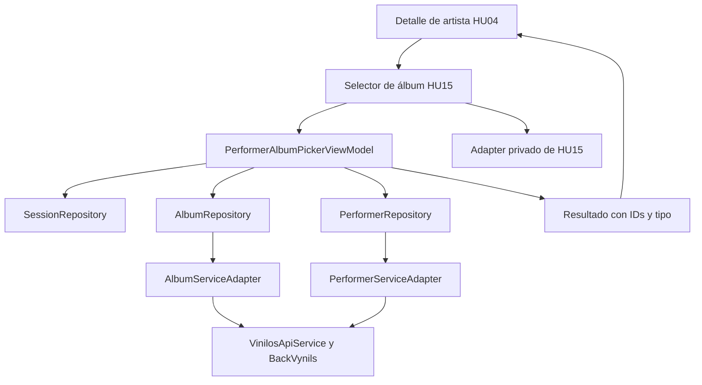
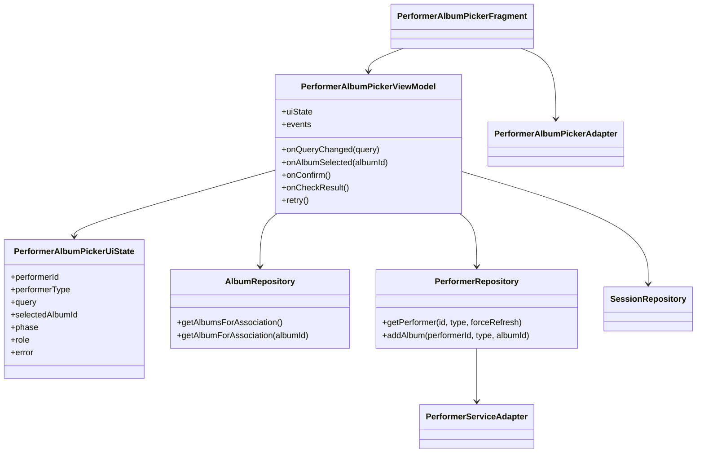
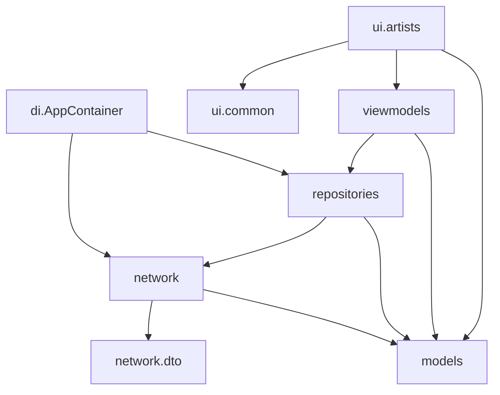
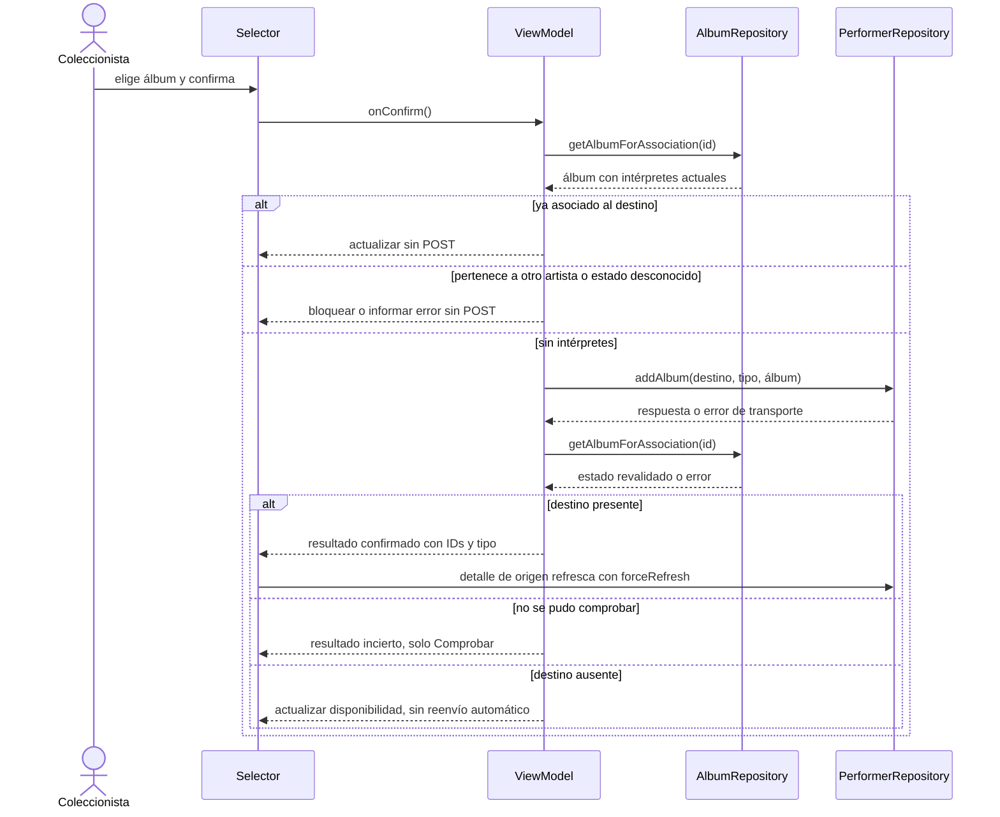

# HU15 · Diseño técnico: agregar un álbum a un artista

**Tarea:** [HU15-01 · #61](https://github.com/misw-is-aplicaciones-moviles/MobileVynils/issues/61). **Responsable:** @ManfredAriel91122. **Fecha:** 17/11/2026.

> Como coleccionista quiero agregar un álbum a un artista para actualizar su información.

**Estado:** diseño de HU15-01 con avance de capa de datos en HU15-02 (sección 10). Se revisaron inicialmente la app en `3f0106b`, los mockups v2 y el código local de BackVynils en `7178f83662022904dc9e88b8a2292568954b56cf`. La interfaz y el flujo completo no están implementados. Las pruebas de datos usan fakes y MockWebServer, sin escrituras a BackVynils. El 17/11 la consulta a `http://127.0.0.1:3000/albums` no pudo conectarse y no había contenedores BackVynils ejecutándose. El contrato HTTP queda pendiente de validación en HU15-06; la inspección del checkout no identifica un despliegue activo.

## 1. Alcance y referencias

HU15 añade la acción «Agregar álbum» al detalle de músico y banda, abre un selector de álbumes y actualiza el detalle después de confirmar la asociación. El Visitante conserva la consulta sin acciones de escritura.

Se mantienen XML, Fragments, ViewBinding, `LiveData`, Repository, Service Adapter, Retrofit y la inyección manual con `AppContainer`. No se cambia el esquema de Room para implementar este selector.

Referencias:

- [Historia en la wiki](https://github.com/misw-is-aplicaciones-moviles/MobileVynils/wiki/HU15).
- [Arquitectura](02-arquitectura.md), [reglas de UI](05-reglas-de-diseno-ui.md), [pruebas](06-pruebas.md).
- [Detalle de artista HU04](13-hu04-diseno-tecnico.md) y [diseño de aplicación](10-diseno-de-la-aplicacion.md).
- Seis PNG originales aportados por el equipo en la carpeta local «Vynils V2 MockUps», revisados como referencia visual y no incluidos en este commit. Se revisaron también el kit v2 y las pantallas combinadas HU12+HU15: agregar un álbum debe conservar los integrantes de la banda.

### Mockups revisados

| Flujo | Archivos de referencia en «Vynils V2 MockUps» |
|---|---|
| Músico | `HU15 · 1 Elegir álbum (músico).png`, `HU15 · 2 Álbum elegido.png`, `HU15 · 3 Álbum agregado al músico.png` |
| Banda | `HU15 · 4 Elegir álbum (banda).png`, `HU15 · 5 Álbum elegido.png`, `HU15 · 6 Álbum agregado a la banda.png` |

Las imágenes permanecen como recursos locales del equipo; esta página registra sus nombres y las decisiones derivadas de su revisión.

Los títulos, años, imágenes y cantidades dibujados son ejemplos. La implementación y las pruebas utilizan los valores del backend, sin fijar Queen, Rubén Blades o los álbumes del mockup.

## 2. Reglas de selección

Los mockups presentan tres situaciones distintas:

| Situación | Presentación | Seleccionable |
|---|---|---|
| El álbum pertenece al artista abierto | Etiqueta «Ya agregado», sin radio activo | No |
| El álbum no tiene intérpretes | Radio disponible; al elegir, fondo seleccionado y marca | Sí |
| El álbum pertenece a otro artista | Fila atenuada y sin radio activo | No |

**Decisión propuesta a partir de los mockups:** HU15 permite incorporar álbumes sin artista; no traslada ni modifica asociaciones de otros artistas. La wiki menciona los endpoints pero no explicita esta restricción, por lo que se registra como una interpretación del diseño visual para revisión del PR. No se atribuye esta regla al backend.

Identidad del destino: par `performerId` + `PerformerType` (`MUSICIAN` o `BAND`), nunca nombre, posición o solo ID. Si el álbum aparece en el detalle del destino, se considera «Ya agregado». Cualquier otra asociación en `performers` impide seleccionarlo; no hace falta conocer el tipo de esos otros intérpretes para bloquearlo. Una respuesta sin el campo `performers` no equivale a una lista explícita vacía: no habilita la asociación.

La búsqueda filtra localmente por nombre del álbum y nombre de sus intérpretes, sin distinguir mayúsculas. No realiza solicitudes por cada tecla. En la UI se conserva el orden alfabético por `name COLLATE NOCASE, id`; las filas bloqueadas permanecen visibles cuando coinciden con la búsqueda.

Al confirmar se vuelve a consultar el álbum con revalidación HTTP:

1. Si continúa sin intérpretes, se permite un solo POST.
2. Si ya figura en el destino, se muestra el estado actualizado sin repetir el POST.
3. Si ahora pertenece a otro artista, se bloquea y se actualiza el selector.
4. Si no se puede determinar su estado, se informa el error y no se envía.

Esta lectura reduce el riesgo de sobrescritura, pero no es una garantía transaccional. Un cliente externo puede cambiar el álbum entre GET y POST. Impedir esa carrera requiere validación atómica del backend y queda fuera de la corrección Android de HU15.

## 3. Contrato del backend y límites encontrados

### Escritura

| Destino | Ruta | Cuerpo | Respuesta descrita por el código local |
|---|---|---|---|
| Músico | `POST /musicians/{performerId}/albums/{albumId}` | Sin cuerpo | HTTP 200, álbum guardado |
| Banda | `POST /bands/{performerId}/albums/{albumId}` | Sin cuerpo | HTTP 200, álbum guardado |

Los controladores usan `@HttpCode(200)` y no reciben `@Body`. El interceptor convierte la ausencia del artista o álbum en HTTP 404. No se presupone que repetir un POST sea idempotente ni que las respuestas remotas coincidan con el checkout hasta ejecutar HU15-06.

### Lecturas

- `GET /albums`: catálogo con relaciones `performers`, según `AlbumService.findAll()`.
- `GET /albums/{albumId}`: comprobación de asociaciones antes/después de escribir.
- `GET /musicians/{performerId}` o `GET /bands/{performerId}`: refresco del detalle y comprobación de la asociación por ID de álbum.

### Hallazgos de código, no reproducciones HTTP

- `MusicianAlbumService.addMusicianAlbum()` añade el músico a la lista de intérpretes existente.
- `BandAlbumService.addBandAlbum()` asigna `album.performers = [band]`: puede sustituir asociaciones existentes. Se evita ofrecer álbumes de otros artistas, pero la carrera entre clientes permanece como limitación.
- `deleteAlbumToMusician()` y `deleteAlbumToBand()` usan un `filter` con bloque sin `return`. Su resultado sería una lista vacía en lugar de conservar las asociaciones ajenas. Las E2E de HU15 no deben limpiar datos compartidos mediante estos métodos sin haber validado su corrección.

Estos hallazgos requieren verificación en una base aislada. No se modificó el backend, no se crearon nuevos issues y no se confirma con esta revisión un borrado o una sobrescritura en un despliegue real.

## 4. Datos completos para el selector

La ruta actual `AlbumRepository.getAlbums(forceRefresh = true)` tampoco basta: después de recibir la red, guarda en Room y devuelve `readAll()`. `AlbumEntity.toModel()` reconstruye `performers = emptyList()` y conserva solo `performerName`. Un álbum ocupado podría parecer libre si el selector usara ese resultado.

Se propone añadir operaciones específicas en `AlbumRepository` y su Service Adapter:

```kotlin
// Contratos implementados en HU15-02.
suspend fun getAlbumsForAssociation(): DataResult<List<Album>, DataError>
suspend fun getAlbumForAssociation(albumId: Int): DataResult<Album, DataError>
```

Ambas leen la red con `Cache-Control: no-cache`, validan que `performers` esté presente y sea una colección válida y conservan sus relaciones en memoria. La primera ordena fuera del hilo principal y no pasa por el resumen de Room; la segunda comprueba que el ID devuelto coincida con el solicitado. Se reutilizan DTO, modelos y mappers existentes, añadiendo validación estricta solo para la decisión de asociación. No se endurecen silenciosamente las lecturas históricas del catálogo ni se interpreta un dato ausente como ausencia de intérpretes.

En HU15-02 se añadió un header opcional con valor predeterminado `null` a `VinilosApiService.getAlbums()`, conservando los llamadores existentes. La lectura estricta del selector usa un método específico `getAlbumsForAssociation()` con `Response<List<AlbumDto?>>` y `Cache-Control: no-cache`, para detectar explícitamente un cuerpo ausente o elementos nulos sin cambiar el contrato tolerante del catálogo anterior. Los Fragments y ViewModels no acceden al Service Adapter ni a DTO directamente.

La escritura se propone en el repositorio del artista:

```kotlin
// Contrato implementado en HU15-02.
suspend fun addAlbum(
    performerId: Int,
    type: PerformerType,
    albumId: Int,
): DataResult<Unit, DataError>
```

`PerformerServiceAdapter` elige el endpoint por el tipo explícito y comprueba la respuesta HTTP y la identidad del álbum cuando exista cuerpo. El Repository convierte los errores esperados mediante `networkRequest`. Un error posterior a enviar no demuestra que el servidor no haya escrito: la UI entra en comprobación, no en reenvío automático.

## 5. Componentes y reutilización

| Componente propuesto o existente | Responsabilidad |
|---|---|
| `PerformerDetailFragment`, `PerformerDetailAdapter` y `PerformerDetailViewModel` existentes | Mostrar la acción solo para Coleccionista con detalle válido; abrir HU15; recibir el resultado y refrescar el artista correcto |
| `PerformerAlbumPickerFragment` propuesto | Selector de HU15, render de estados y navegación; no hace peticiones HTTP directamente |
| `PerformerAlbumPickerViewModel`, `UiState` y `Event` propuestos | Catálogo completo, búsqueda, disponibilidad, selección, sesión y operación de asociación |
| Constantes de `PerformerAlbumPickerViewModel` | Claves de argumentos y resultado: IDs y tipo, sin objetos completos en el Bundle |
| `PerformerAlbumPickerAdapter` privado y `PerformerAlbumPickerOption` | Presentación específica de HU15; la opción conserva el álbum, selección y motivo de bloqueo |
| `AlbumRepository` y `AlbumServiceAdapter` existentes, ampliados | Lecturas completas y revalidadas para decidir asociaciones |
| `PerformerRepository` y `PerformerServiceAdapter` existentes, ampliados | Asociar al músico/banda y recuperar el detalle |

HU11 ya aporta cabecera, búsqueda, estilos de filas, controles de selección, recursos y patrón de carga. Se reutilizan los recursos compatibles; el adaptador de HU15 permanece privado en su Fragment. No se cambia el flujo de precio/estado ni las reglas de HU11. La pantalla de HU15 confirma directamente; no abre la hoja «Precio y estado».

El alcance de esta implementación es HU15. No se crea infraestructura compartida para HU12/HU10 ni se modifican sus flujos.

### Diagrama de componentes



### Diagrama de clases



### Diagrama de paquetes



Las flechas representan dependencias propuestas, no cambios ya aplicados. `ui` no importa `network` ni repositorios y la lógica de presentación no recibe vistas o `Context`.

## 6. Pantalla, estados y accesibilidad

| Elemento | Comportamiento |
|---|---|
| Cabecera | X en círculo, «Elegir álbum», chip de rol Coleccionista; sin barra inferior en el selector |
| Contexto | «para {nombre del artista}», obtenido del destino real |
| Búsqueda | «Buscar en el catálogo», filtro local sin llamadas por tecla |
| Opciones | Portada con disco, nombre, artista/género/año según los datos y el estado visual del kit; nombres de ejemplo nunca codificados |
| Pie | «Selecciona un álbum» deshabilitado; con selección «Agregar «{nombre}»» habilitado |
| Éxito | Volver al mismo músico/banda, refrescar «Álbumes · N», mostrar la fila incorporada resaltada y «Álbum agregado al artista» |

Estados propuestos: `Loading`, `Content`, `Empty`, `LoadError`, `Checking`, `Submitting`, `CheckingResult` y `UnknownResult`. La ausencia de coincidencias es un estado derivado de `Content`, distinto de catálogo vacío. Solo `Content` con selección elegible, identidad válida y rol Coleccionista permite confirmar.

- `SavedStateHandle` conserva destino, búsqueda, selección y marca de operación incierta; no guarda DTO ni el catálogo entero. Tras muerte de proceso se recarga y revalida. Si había una escritura en curso, solo se comprueba su resultado, nunca se reenvía al restaurar.
- Un `Job`/guardia de operación impide confirmaciones simultáneas. La búsqueda cancela el cálculo anterior y publica solo el resultado vigente, usando `Dispatchers.Default`.
- Mientras se envía no se permite cambiar la selección ni se considera cerrar la pantalla como prueba de cancelación remota. Si se sale durante una escritura, el siguiente acceso revalida el detalle; la cancelación local no revierte el POST.
- El cambio de rol cancela cargas de lectura y retira la capacidad de escribir. Si había envío iniciado, se conserva la necesidad de comprobar su resultado; no se afirma que no ocurrió por perder el rol.
- Recursos de texto y dimensiones centralizados, controles de al menos 48 × 48 dp, textos en `sp`, contraste verificado y estados identificables sin depender solo del color.
- El lector anuncia nombre, estado y selección; los bloqueados siguen siendo comprensibles y no activables. Las imágenes decorativas no duplican la etiqueta de la fila.
- Reutilizar Glide ligado al Fragment, tamaño de imagen acotado, `ListAdapter`/`DiffUtil`, `viewLifecycleOwner` y liberación de binding/adapter en `onDestroyView`.
- Comprobar Scanner, TalkBack, texto ampliado, teclado/insets y scroll en API 21 y API 37. Son validaciones pendientes, no resultados de esta tarea documental.

## 7. Secuencia de confirmación y resultado incierto



Una respuesta perdida, HTTP 5xx, cuerpo inválido o cancelación después del envío pueden dejar una escritura realizada. `NetworkClient` ya tiene `retryOnConnectionFailure(false)` y se conserva esa política. «Comprobar» hace GET, no POST. Si la lectura confirma que sigue libre, se habilita un nuevo intento explícito del usuario. Si figura otro artista, se bloquea. Si no puede verificarse, permanece incierto.

Una lectura que muestra al destino confirma el estado final, no demuestra por sí sola qué cliente creó el vínculo. Si ya estaba asociado antes del POST, se informa como existente y no como una nueva escritura propia.

Después de confirmar se devuelve un Bundle de IDs, tipo e indicador de actualización al detalle mediante `SavedStateHandle`, con consumo de una sola vez. El detalle conserva el contexto de navegación y revalida sus álbumes. Si ese refresco falla, se mantiene el resultado confirmado y se ofrece reintentar la lectura; no se repite la escritura ni se inventa un contador.

La próxima lectura del catálogo/resumen de artista debe revalidar los datos afectados para actualizar nombres y cantidades. No se reconstruye una caché completa con una respuesta parcial de POST. La actualización de caché es secundaria: un fallo local después de confirmar en red no se presenta como fallo de asociación.

## 8. Plan de implementación y validación

| Tarea | Issue | Entregable |
|---|---|---|
| HU15-01 | [#61](https://github.com/misw-is-aplicaciones-moviles/MobileVynils/issues/61) | Este diseño, nombres de mockups revisados y decisiones revisables |
| HU15-06, verificación temprana | [#66](https://github.com/misw-is-aplicaciones-moviles/MobileVynils/issues/66) | Contrato de ambas rutas comprobado en backend aislado antes de confiar en sus respuestas |
| HU15-02 | [#62](https://github.com/misw-is-aplicaciones-moviles/MobileVynils/issues/62) | Lecturas completas, endpoints, adaptadores, repositorios y pruebas de datos |
| HU15-03 | [#63](https://github.com/misw-is-aplicaciones-moviles/MobileVynils/issues/63) | Acción del detalle, selector, resultado y recursos accesibles |
| HU15-04 | [#64](https://github.com/misw-is-aplicaciones-moviles/MobileVynils/issues/64) | Pruebas unitarias por tipo, disponibilidad, rol, estado y errores |
| HU15-05 | [#65](https://github.com/misw-is-aplicaciones-moviles/MobileVynils/issues/65) | Espresso, resultados API 21/API 37 y regresión pertinente |

### Inventario propuesto; no ejecutado

Los códigos siguientes son locales de HU15. La numeración global PE de la wiki se asigna al consolidar, sin sobrescribir los escenarios históricos.

| Caso | Comprobación | Nivel |
|---|---|---|
| CP-HU15-01 | Agregar álbum libre a músico, confirmar relación y detalle actualizado | API y E2E |
| CP-HU15-02 | Agregar álbum libre a banda sin cambiar sus integrantes ni premios | API y E2E |
| CP-HU15-03 | «Ya agregado» bloqueado, sin segundo POST | Unitaria y E2E |
| CP-HU15-04 | Álbum de otro artista atenuado y no seleccionable; asociaciones conservadas | Unitaria y E2E |
| CP-HU15-05 | Búsqueda por nombre/artista, sin resultados, selección y catálogo vacío | Unitaria y E2E |
| CP-HU15-06 | Visitante, cambio de rol, ID o tipo inválido: no se escribe | Unitaria y E2E |
| CP-HU15-07 | Cerrar sin enviar, búsqueda/selección tras recreación y regreso al origen | Unitaria y E2E |
| CP-HU15-08 | Error de carga y reintento; ausencia o formato inválido de `performers` no habilita | Datos y unitaria |
| CP-HU15-09 | Doble confirmación, estado obsoleto y pérdida de respuesta: un POST, comprobación y reintento explícito | Datos, unitaria y E2E con transporte controlado |
| CP-HU15-10 | 404, 5xx y JSON inválido; ruta distinta según músico/banda, sin cuerpo | API y MockWebServer |
| CP-HU15-11 | Éxito remoto y fallo de refresco/caché no repiten la asociación | Unitaria y E2E controlada |
| CP-HU15-12 | TalkBack, Scanner, fuente ampliada e insets; seleccionar no depende solo del color | Manual y accesibilidad |
| CP-HU15-13 | Regresión HU03/HU04/HU11/HU14 y composición HU12+HU15 cuando HU12 esté integrada | Suite y E2E |

Las pruebas unitarias de datos deben detectar el caso crítico donde Room devuelve `performers` vacío para un álbum ocupado. Las de transporte comprueban URLs, ausencia de cuerpo, headers de revalidación y respuesta ante contenido inconsistente. Se prueban músicos y bandas con IDs que no se utilicen para inferir el tipo.

Las E2E utilizan un backend aislado y recursos exclusivos de la corrida. Se valida primero la generación de IDs y el procedimiento de limpieza; no se crean o borran vínculos de la semilla para preparar estas pruebas. Hasta comprobar los DELETE observados, se usa un entorno desechable o una limpieza validada que no dependa de ellos. No se reinicia ni elimina el entorno compartido del equipo.

## 9. Archivos previstos y comprobación de cierre

Se prevén cambios en `VinilosApiService`, adaptadores y repositorios de álbum/artista, sus fakes y pruebas; clases del selector en `ui/artists` y `viewmodels`; componente de opciones en `ui/common`; navegación, `MainActivity` si necesita registrar el nuevo destino, recursos y detalle de artista. Se actualiza `AppContainer` solo cuando los contratos nuevos requieran dependencias adicionales. Los nombres finales se fijan al implementar, manteniendo la separación de capas.

Para cerrar la implementación completa, no solo HU15-01:

- Controles `spotlessCheck`, `detekt`, `lintDebug` y `testDebugUnitTest` correctos.
- Espresso del flujo nuevo y regresión afectada en API 21 y API 37; ejecución directa con `am instrument` si el runner Gradle de API 21 presenta el problema documentado.
- Evidencias visuales comparadas con los mockups identificados en esta página y auditoría de accesibilidad del flujo.
- Inventario, resultados y limitaciones reales publicados, con PR por tarea según el flujo del repositorio.

**Pendientes explícitos:** validar HTTP en backend aislado; revisar la interpretación de álbumes de otros artistas con el equipo; completar la cobertura de ViewModel y las E2E, la auditoría de accesibilidad y publicar sus resultados. Los avances de datos/UI no equivalen a validar HU15 contra el backend real.

## 10. Avance HU15-02 · Capa de datos

Rama de subtarea: `feature/HU15-02-datos`, creada desde la rama de integración `feature/HU15-agregar-album-artista` después de integrar HU15-01. Issue: [#62](https://github.com/misw-is-aplicaciones-moviles/MobileVynils/issues/62).

- Implementados los POST sin cuerpo para músico y banda. El Service Adapter usa `PerformerType`, exige IDs positivos y valida el ID del álbum devuelto. La frontera de errores sigue siendo el Repository; se propagan las cancelaciones.
- Implementadas las lecturas completas del selector y la comprobación individual, siempre revalidadas y sin leer ni escribir el resumen de Room. `performers` ausente, nulo o malformado produce error de serialización; no se confunde con una lista explícitamente vacía. Un intérprete con ID y nombre válidos pero tipo desconocido se conserva como asociación existente.
- El catálogo de asociación conserva el orden de Room (`name COLLATE NOCASE, id`) sin perder intérpretes. Se mantiene el comportamiento tolerante del catálogo histórico en sus lecturas normales.
- El catálogo ordinario de álbumes y las listas de artistas aceptan revalidación HTTP al solicitar un refresco forzado. Esto permite que el próximo paso de UI refresque los resúmenes afectados después de asociar.
- `PerformerRepository.addAlbum()` marca el resumen de artistas como pendiente de revalidación antes de enviar, incluso si la respuesta se pierde. La siguiente lectura de detalle o lista no reutiliza la caché HTTP sin revalidar; `hasCachedPerformers()` devuelve falso hasta completar la actualización del resumen local.
- La escritura y el refresco de lista comparten el mutex existente. Un refresco iniciado antes del POST no puede terminar después y borrar la marca de revalidación. Un fallo de Room mantiene la marca y devuelve la respuesta remota; no revierte ni repite la escritura.
- `addAlbum()` no ejecuta lecturas ni reenvíos ocultos. La comprobación de disponibilidad antes de escribir, el estado de resultado incierto y la actualización visible del detalle se conectarán en HU15-03. La capa de datos no afirma que una respuesta perdida signifique ausencia de asociación.

**Pruebas nuevas:** `AlbumAssociationServiceAdapterTest` (11), `PerformerAlbumServiceAdapterTest` (8), `AlbumAssociationRepositoryTest` (8) y `PerformerAlbumRepositoryTest` (9): 36 casos JVM. Incluyen peticiones reales a MockWebServer para rutas, headers, cuerpos, JSON inválido y respuesta perdida; fakes para caché, errores, cancelación y orden concurrente de refresco/escritura. No sustituyen las pruebas HTTP contra BackVynils de HU15-06 ni las pruebas de UI/E2E.

**Validación local de HU15-02 (17/11/2026):** JDK 17; `spotlessCheck`, `detekt`, `lintDebug`, `testDebugUnitTest` y `assembleDebug` correctos. Suite completa: **396 pruebas JVM, 0 fallos, 0 errores y 0 omisiones**, incluidas las 36 nuevas. No se ejecutaron pruebas instrumentadas ni peticiones contra BackVynils como parte de esta subtarea. No se reemplazó el APK de entrega del repositorio.

## 11. Avance HU15-03 · Selector y regreso al detalle

Rama de subtarea: `feature/HU15-03-selector`, creada desde `feature/HU15-agregar-album-artista` después de integrar HU15-02. Issue: [#63](https://github.com/misw-is-aplicaciones-moviles/MobileVynils/issues/63).

- Acción **Agregar álbum** junto al contador de álbumes, disponible únicamente para Coleccionista, tanto en músicos como en bandas. Se conserva la identidad compuesta por ID y tipo durante la navegación.
- Selector con búsqueda por álbum/artista, selección única, álbumes propios marcados **Ya agregado**, álbumes ocupados bloqueados, estados de carga/error/vacío y reintento. Se conservan búsqueda y selección con `SavedStateHandle`. La selección no depende exclusivamente del color: incluye check y descripción accesible.
- Implementación específica de HU15, siguiendo el patrón de HU11: adaptador privado dentro del Fragment, opción junto al estado de UI y claves de navegación en el ViewModel. No se introduce un selector genérico ni se modifican HU11/HU12/HU10. Se usa un único estado de operación en curso; las comprobaciones de seguridad permanecen iguales.
- Antes de escribir se revalida el álbum completo. Una asociación existente al destino regresa sin POST; un álbum ocupado por otro artista se bloquea. Si falta el subtipo en la relación anidada, se consulta el detalle tipado antes de atribuir pertenencia.
- Doble confirmación y salida durante la operación se bloquean. Después del POST, incluso si devuelve un error de transporte, se comprueba la relación con otra lectura. Un resultado incierto muestra **Comprobar asociación** y no reenvía el POST. Al restaurar un envío pendiente se conserva este bloqueo; nunca se reenvía automáticamente.
- El éxito confirmado vuelve al detalle original, solicita datos frescos y resalta el álbum. No se incrementa el contador con datos inventados ni se altera localmente la lista de integrantes o premios. Si falla el refresco del detalle, su reintento es solo de lectura y no repite la asociación.

Las comprobaciones previas reducen el riesgo de sobrescribir relaciones existentes, pero no constituyen una operación atómica entre clientes: el backend debe resolver la concurrencia. Sigue pendiente comprobar el contrato real de las rutas de BackVynils en HU15-06.

**Cobertura inicial de UI lógica:** `PerformerAlbumPickerViewModelTest` (11 casos) y `PerformerAlbumDetailResultTest` (3 casos). Incluyen músico/banda, rol, búsqueda, selección, asociación concurrente detectada en preflight, respuesta perdida, resultado incierto, restauración, doble toque e identidad del resultado. HU15-04 ampliará la cobertura y HU15-05 incorporará los escenarios Espresso específicos.


**Validación local HU15-03 (17/11/2026):** `spotlessCheck`, `detekt`, `lintDebug`, `testDebugUnitTest`, `assembleDebug` y `assembleDebugAndroidTest` correctos; **410 pruebas JVM, 0 fallos, 0 errores y 0 omisiones**. Revisión visual exploratoria con fixtures HTTP en memoria: músico en emulador API 21 y banda en emulador API 37, selección, confirmación y detalle refrescado con resaltado; un POST por recorrido en el log del simulador. El fixture de banda conservó sus cuatro integrantes. No se ejecutó Espresso específico de HU15, no se validó contra BackVynils real ni se auditó aún con TalkBack/Scanner/fuente ampliada. No se guardaron fotos en el repositorio ni se reemplazó el APK de entrega.

**Simplificación de HU15-03:** se retiraron los tres archivos independientes del modelo genérico, adaptador compartido y contrato de claves. La presentación queda específica de esta HU, sin anticipar infraestructura para otras historias. Después de simplificar se repitieron los controles de compilación, análisis y las 410 pruebas JVM; la revisión visual exploratoria anterior no se volvió a ejecutar.
