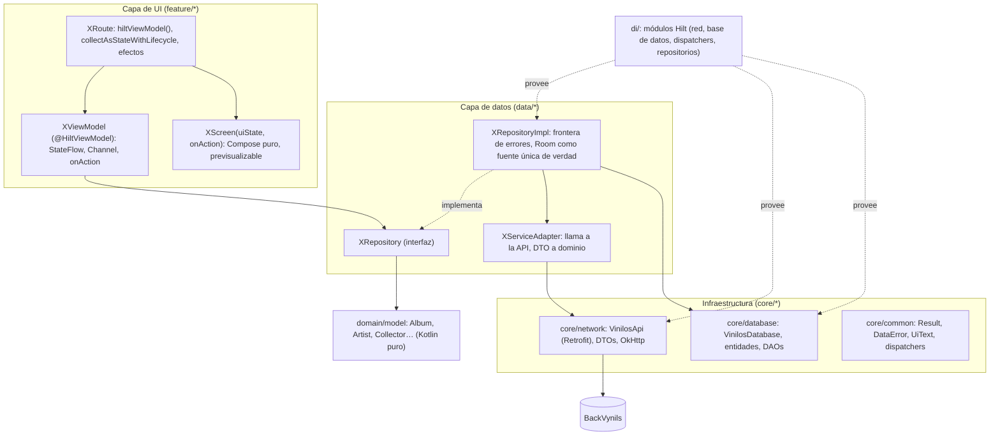
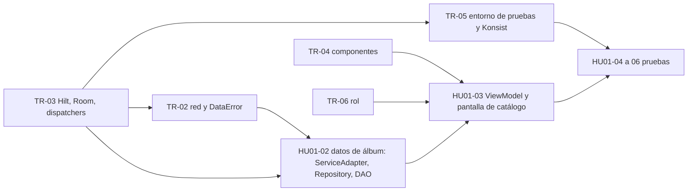

# Arquitectura de la app: estado y brechas

Revisión del 2026-10-21 sobre la rama `feature/TR01-project-theme-navigation` (PR #82). Contrasta el código actual con la arquitectura exigida por el curso (MVVM con Repository, Service Adapter y Room) y descrita en `docs/02-arquitectura.md`, y lista lo que falta y quién lo implementa.

## 1. Veredicto

La app **todavía no aplica MVVM con Repository**: solo existe la capa de presentación base (tema, navegación inferior y pantallas provisionales de TR-01). No hay ViewModels, repositorios, Service Adapters, Room ni inyección de dependencias, porque ninguna historia consume datos aún. No es un defecto de TR-01, sino trabajo pendiente de las tareas transversales TR-02, TR-03, TR-05 y TR-06 y de HU01-02 y HU01-03.

Lo que ya existe respeta la arquitectura objetivo y no habrá que rehacerlo: paquetes `core/ui/theme` y `core/ui/navigation`, rutas tipadas en `Routes.kt`, un único `NavHost`, pantallas que reciben estado y no conocen la navegación, y textos en `strings.xml`.

## 2. Arquitectura objetivo

Flujo: la pantalla envía acciones al ViewModel; el ViewModel pide datos al Repository y expone un `UiState` inmutable; el Repository observa Room y, al refrescar, pide al Service Adapter, guarda en Room y convierte cualquier error en `DataError`. La UI nunca ve DTOs, entidades ni excepciones.

## 3. Estado actual frente al objetivo

| Pieza de la arquitectura | Estado | Dónde debe vivir | Tarea que la cierra |
|---|---|---|---|
| Tema, tipografías, formas | Hecho | `core/ui/theme` | TR-01 (PR #82) |
| Rutas tipadas, `NavHost`, barra inferior, transiciones | Hecho | `core/ui/navigation` | TR-01 (PR #82) |
| `Application` con `@HiltAndroidApp`, Hilt y KSP | Falta | `VinilosApplication`, `di/` | TR-03 (Daniela) |
| Dispatchers inyectados (`@IoDispatcher`…) | Falta | `core/common`, `di/` | TR-03 (Daniela) |
| `Result`, `DataError`, `UiText` | Falta | `core/common` | TR-02 (Manfred) |
| Retrofit, OkHttp, conversor kotlinx.serialization, `VinilosApi`, URL base por `BuildConfig`, permiso `INTERNET`, tráfico en claro solo en `debug` | Falta | `core/network`, `di/NetworkModule` | TR-02 (Manfred) |
| Room: `VinilosDatabase`, entidades y DAOs, KSP | Falta | `core/database`, `di/DatabaseModule` | TR-03 (Daniela) |
| Modelos de dominio | Falta | `domain/model` | HU01-02 y siguientes (cada historia añade los suyos) |
| `AlbumServiceAdapter`, `AlbumRepository`, `AlbumRepositoryImpl`, mappers | Falta | `data/album` | HU01-02 (Yoimar) |
| `SessionRepository` y rol | Falta | `data/session`, `feature/session` | TR-06 (Jhon Jairo) |
| `AlbumListViewModel`, `AlbumListUiState`, acciones y efectos; `AlbumListRoute` y `AlbumListScreen` | Falta | `feature/albums/list` | HU01-03 (Yoimar) |
| Componentes compartidos (`VinilosTopBar` con `RoleChip`, estados de carga, error y vacío) | Falta; hoy la cabecera vive dentro de `PendingTabScreen` | `core/ui/components` | TR-04 (Jhon Jairo) |
| `lifecycle-viewmodel-compose`, `hilt-navigation-compose`, `collectAsStateWithLifecycle` | Falta | Catálogo de versiones | TR-03 / HU01-03 |
| Pruebas de arquitectura con Konsist | Falta | `src/test/.../architecture` | TR-05 (Daniela) |
| MockK, Turbine, coroutines-test, MockWebServer | Falta | Catálogo y `src/test` | TR-05 (Daniela) |
| Coil para carátulas | Falta | Catálogo, `core/ui/components/AlbumCover` | HU01-03 (Yoimar) |

## 4. Reglas que la implementación debe cumplir

Se verifican con Konsist (TR-05) y en la revisión de cada PR:

1. `feature/*` solo importa `domain/model`, `core/common`, `core/ui` y las interfaces `data/*/*Repository`; nunca `core/network`, `core/database` ni `*RepositoryImpl`.
2. `data/*` no importa Compose ni `feature/*`.
3. `domain/model` no importa Android ni AndroidX.
4. Cada pantalla tiene un `XViewModel` con `@HiltViewModel`, un `XUiState` inmutable con `canEdit`, y se divide en `XRoute` (conectada) y `XScreen` (pura).
5. Los repositorios son la única puerta a los datos y la frontera de errores: devuelven `Result<T, DataError>` o `Flow<T>`; `CancellationException` nunca se captura.
6. Ninguna E/S ni mapeo pesado en el hilo principal: dispatchers inyectados.

## 5. Orden de implementación recomendado

TR-03 va primero porque Hilt es la base del resto (la red, la base de datos y los ViewModels se inyectan). Con TR-02 y TR-03 integradas, HU01-02 ya puede construir la capa de datos completa del álbum aunque la UI espere a TR-04 y TR-06.

## 6. Lista de verificación de un PR con arquitectura

- [ ] La clase está en el paquete de su capa (sección 3) y Konsist pasa.
- [ ] La pantalla tiene ViewModel, `UiState` inmutable con cuatro estados (cargando, contenido, vacío, error) y `canEdit`.
- [ ] La UI no importa DTOs, entidades, Retrofit ni Room.
- [ ] El repositorio convierte las excepciones en `DataError` y lee de Room.
- [ ] Hay pruebas unitarias del ViewModel y del repositorio.

## 7. Bitácora

| Fecha | Nota |
|---|---|
| 2026-10-21 | Primera revisión. Solo la capa de presentación base existe (TR-01); MVVM con Repository pendiente de TR-02, TR-03, TR-04, TR-05, TR-06, HU01-02 y HU01-03. |
