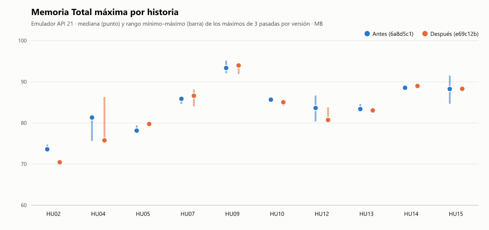
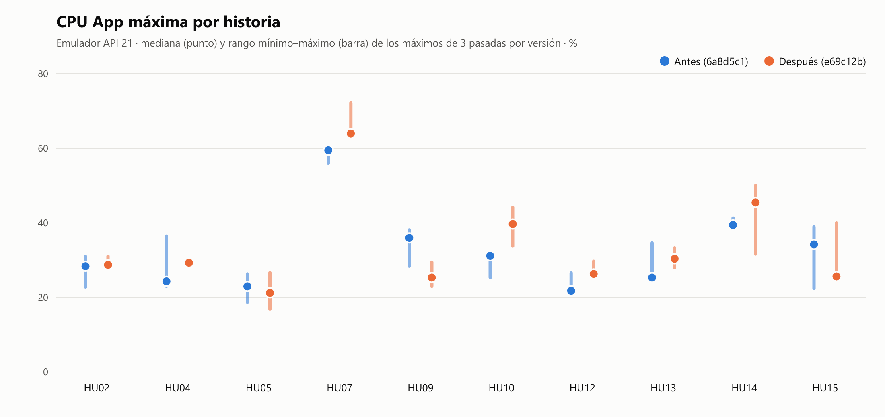
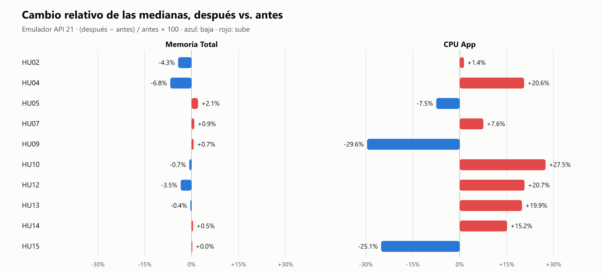

# Reporte de perfilamiento de desempeño: Sprint 3 — Emulador API 21

## 1. Objetivo

Comparar CPU App y memoria Total en diez historias, antes y después de las optimizaciones, en el mismo emulador con Android 5.0 (API 21), la versión mínima que soporta la app (`minSdk 21`). Este aporte cubre solo el dispositivo 4 del reporte del Sprint 3. Replica el protocolo del Huawei P20 en todo lo posible; las diferencias se explican en la sección 4.

## 2. Historias evaluadas

Son las mismas diez del aporte del P20, con el mismo inicio, acción y fin:

- **HU02:** Consultar el detalle de un álbum.
- **HU04:** Consultar el detalle de un artista.
- **HU05:** Consultar el listado de coleccionistas.
- **HU07:** Crear un álbum.
- **HU09:** Comentar un álbum.
- **HU10:** Agregar un artista favorito.
- **HU12:** Agregar un músico a una banda.
- **HU13:** Crear un premio.
- **HU14:** Asignar un premio a un artista.
- **HU15:** Agregar un álbum a un artista.

## 3. Entorno

| Característica | Valor |
|---|---|
| Dispositivo | Emulador Android, AVD `Vinilos_API_21` (perfil Pixel 4) |
| Imagen de sistema | `android-21` · `default` · `x86_64`, sin Play Store; Android 5.0.2 |
| CPU y memoria | x86_64 virtual de 4 núcleos; 2 GB de RAM; heap de VM 256 MB |
| Pantalla | 1080 × 2280, densidad 440; fuente del sistema 1.0 |
| Emulador | 37.2.12.0, aceleración WHPX, `-gpu host`, arranque en frío con datos borrados (`-no-snapshot -wipe-data`) |
| Anfitrión | Windows 11 Pro (10.0.26300) |
| Backend | BackVynils local en Docker, alcanzado desde el emulador en `10.0.2.2:3000` |
| Teclado | AOSP LatinIME desactivado (`ime disable`), para que el texto escrito por ADB no se corrija |

Los valores dependen del equipo anfitrión y de la CPU virtual. Se comparan antes y después en el mismo emulador, no directamente con los teléfonos físicos.

## 4. Metodología

### 4.1. Versiones

- **Antes:** `develop-bo2`, commit `6a8d5c15d6ff32b2355ecc7c7eb90da147680b65`. APK `antes-6a8d5c1.apk`, SHA-256 `beedf01d5da8de393da0570d912c791655aab5b2bb48ba4c35b85b5b6027efe0`.
- **Después:** `develop`, commit `e69c12b902b7b6998dfe489a58cc69d1a9056463`. APK `despues-e69c12b.apk`, SHA-256 `f4234614dfded91c698ad08ef1418a78340e87710eff1567d9c4338ec842545d`.

Son las mismas versiones del P20. Ambos APK son **debuggable**, con versión visible `3.0.0b` y código 3 para permitir reinstalar. En «antes» solo se cambiaron `versionCode` y `versionName`, sin commit.

### 4.2. Por qué no Android Studio

El perfilador de Android Studio 2026.2 no funciona en API 21. Al conectarse, Studio envía el demonio `transport` al dispositivo, y el enlazador de Android 5.0 lo rechaza:

`CANNOT LINK EXECUTABLE: empty/missing DT_HASH in "/data/local/tmp/perfd/transport" (built with --hash-style=gnu?)`

Lo mismo pasa con `process-tracker`. Sin ese demonio no hay eventos `MEMORY_USAGE` ni `CPU_USAGE`, así que no se puede generar el `.asdb`. Por eso el emulador se midió por ADB, **con las mismas fórmulas de Studio**.

### 4.3. Cómo se midió

- **Memoria Total (MB):** memoria **privada** del proceso (Private_Dirty + Private_Clean), que es lo que grafica Studio, no PSS. Se lee de `/proc/PID/smaps` cada 0.5 s con `run-as`, **en un proceso aparte**. Cada región se clasifica como en `android_os_Debug.cpp` de Android 5.0, y se agrupa con las categorías de la «App Summary»:
  - **Java:** Dalvik Heap privada sucia más `.art`.
  - **Native:** Native Heap privada sucia.
  - **Code:** `.so`, `.jar`, `.apk`, `.ttf`, `.dex` y `.oat`.
  - **Stack.**
  - **Graphics:** Gfx dev, EGL mtrack y GL mtrack.
  - **Others:** el resto.

  El PSS se conserva solo como referencia.
- **Validación de la memoria:** sobre el mismo proceso, la lectura de `smaps` coincidió con `dumpsys meminfo`:
  - Total privada: 30 596 KB en ambos.
  - PSS: 34 216 KB en ambos.
  - Native: 7 840 KB en ambos.
  - Stack: 152 KB en ambos.
  - Java: 8 328 KB en ambos.
  - Code: 13 280 KB frente a 13 216 KB, una diferencia de 64 KB.
- **Por qué no se usó `dumpsys meminfo` para muestrear:** en una primera prueba se descartó. En Android 5.0, cada llamada cuenta objetos de la app con `Debug.countInstancesOfClass`, y eso fuerza unas siete recolecciones de basura completas dentro del proceso. En la prueba aparecieron 2 785 GC «Explicit» en Logcat, lo que altera la memoria y la CPU que se quieren medir. En las seis pasadas formales hubo **0** GC «Explicit» del proceso de la app.
- **CPU App (%):** cada 0.2 s, un ciclo en el dispositivo lee `/proc/PID/stat` y `/proc/stat` usando solo el comando interno `read`. CPU App = Δ(utime + stime del proceso) / Δ(tiempo de CPU de los 4 núcleos) × 100, limitado a 0–100. Es la misma fórmula que el extractor del `.asdb` del P20. También se guarda el entero que mostraría Studio, por truncamiento.
- **Ventanas:** cada historia tiene una ventana. Empieza justo antes de la primera acción y termina tras 10 s de reposo, con el reloj `uptime` del dispositivo. Las ventanas quedan en `ventanas.json`. El pico de cada historia es el máximo de las muestras dentro de su ventana.
- **Resultado por historia:** mediana y rango mínimo–máximo de los tres máximos de cada versión. Δ = (después − antes) / antes × 100. El tiempo E2E no se midió. No se ejecutaron System Trace ni Heap Dump.

### 4.4. Ejecución

- **Pasadas:** 3 antes y luego 3 después, el 22/11/2026 entre las 14:20 y las 15:12 (hora de Colombia). Cada pasada duró unos 8 min 40 s.
- **Preparación de cada pasada:**
  - backend reiniciado con la semilla (`docker compose down -v` y `up -d`) y los datos de prueba creados por la API;
  - app instalada y datos borrados (`pm clear`);
  - entrada como coleccionista y 10 s de calentamiento en el catálogo.
- **Proceso de la app:** se conserva entre las diez historias y no se fuerza GC.
- **Datos de prueba**, equivalentes a los del P20:
  - coleccionista y banda «API21 Perfilamiento»;
  - músico libre «API21 Musico»;
  - álbum «API21 Album» y premio «API21 Premio»;
  - comentario fijo de 30 dígitos con valoración 4;
  - Queen como favorito;
  - el álbum creado es «Zeta API21» y el premio creado, «Zeta Premio».
- **Automatización:**
  - Cada historia se prepara fuera de su ventana, buscando los controles en la jerarquía de vistas.
  - Dentro de la ventana solo hay toques, desplazamientos y escritura por ADB en coordenadas fijas.
  - Las pausas son iguales en todas las pasadas: 2 s por acción y 0.3 s por carácter.
  - Las capturas del emulador y las comprobaciones del backend se hacen después de cerrar cada ventana.
- **Comprobación funcional:** después de cada ventana se revisa la pantalla o el backend: álbum creado, comentario, favorito, integrante, premio creado, premio asignado y álbum asociado. Las 60 comprobaciones dieron OK.

Duración mediana de las ventanas (s), casi igual entre versiones:

| HU | Antes | Después | Acciones |
|---|---:|---:|---:|
| HU02 | 18.1 | 18.1 | 3 |
| HU04 | 28.5 | 28.4 | 7 |
| HU05 | 18.1 | 18.1 | 3 |
| HU07 | 83.0 | 83.7 | 71 |
| HU09 | 46.8 | 46.9 | 36 |
| HU10 | 25.1 | 25.0 | 9 |
| HU12 | 25.1 | 25.1 | 9 |
| HU13 | 51.5 | 51.6 | 40 |
| HU14 | 34.5 | 34.5 | 13 |
| HU15 | 26.4 | 26.4 | 11 |

### 4.5. Intentos excluidos

- **Primer piloto:** usaba `dumpsys meminfo` y se descartó por las GC forzadas. Además, una consulta manual a uiautomator durante la pasada chocó con la del script.
- **Segundo piloto:** abortó por un error del script, un parámetro sin valor.
- **Pilotos válidos:** uno con cada versión. El de «después» mostró que la hoja «Comentar álbum» no se despliega completa en la primera apertura (§ 7). Por eso se agregó al cuerpo de HU09 un arrastre hacia arriba en el margen de la hoja, **en las dos versiones**, para que tengan las mismas acciones.

Ningún piloto entra en los resultados. Las seis pasadas formales se conservan completas, también sus valores desfavorables.

## 5. Resultados

Valores: **mediana (mínimo–máximo)** de tres máximos. Un Δ negativo indica que bajó el máximo observado; por sí solo no demuestra una mejora perceptible.

| HU | Total antes MB | Total después MB | Δ memoria | CPU App antes % | CPU App después % | Δ CPU |
|---|---:|---:|---:|---:|---:|---:|
| HU02 | 73.6 (73.2–74.6) | 70.4 (70.1–70.6) | -4.3% | 28.4 (22.8–31.0) | 28.8 (27.8–31.1) | +1.4% |
| HU04 | 81.3 (75.8–81.9) | 75.8 (75.6–86.1) | -6.8% | 24.3 (23.0–36.5) | 29.3 (28.8–29.5) | +20.6% |
| HU05 | 78.1 (78.0–79.2) | 79.8 (79.1–80.1) | +2.1% | 23.0 (18.8–26.3) | 21.3 (16.9–26.7) | -7.5% |
| HU07 | 85.9 (84.8–86.2) | 86.6 (84.2–88.0) | +0.9% | 59.5 (56.0–60.5) | 64.0 (63.6–72.2) | +7.6% |
| HU09 | 93.4 (92.2–95.0) | 94.0 (92.1–94.2) | +0.7% | 36.0 (28.4–38.2) | 25.3 (23.0–29.5) | -29.6% |
| HU10 | 85.7 (85.1–85.8) | 85.0 (84.3–85.1) | -0.7% | 31.2 (25.3–31.5) | 39.7 (33.8–44.2) | +27.5% |
| HU12 | 83.6 (80.5–86.5) | 80.7 (80.2–83.6) | -3.5% | 21.8 (20.8–26.6) | 26.3 (26.3–29.7) | +20.7% |
| HU13 | 83.4 (83.0–84.4) | 83.1 (83.0–83.2) | -0.4% | 25.3 (25.3–34.7) | 30.4 (28.0–33.3) | +19.9% |
| HU14 | 88.6 (88.3–88.7) | 89.0 (88.7–89.1) | +0.5% | 39.5 (38.7–41.3) | 45.5 (31.6–50.0) | +15.2% |
| HU15 | 88.3 (84.8–91.3) | 88.3 (88.3–88.5) | +0.0% | 34.2 (22.4–39.0) | 25.6 (24.7–40.0) | -25.1% |

### 5.1. Memoria

- **Bajan seis medianas:** HU02 (−4.3 %), HU04 (−6.8 %), HU10 (−0.7 %), HU12 (−3.5 %), HU13 (−0.4 %) y HU15 (0.0 %).
- **Suben cuatro:** HU05 (+2.1 %), HU07 (+0.9 %), HU09 (+0.7 %) y HU14 (+0.5 %).
- Salvo HU02 y HU04, los cambios están por debajo del 4 %, en el orden de la variación entre pasadas.
- **Rangos sin solapamiento:**
  - En HU02, los tres máximos de después (70.1–70.6 MB) quedan por debajo de los tres de antes (73.2–74.6 MB). En el pico, Java baja de 30.2 a 27.9 MB (medianas). Esto concuerda con `fd56c1c`, que conserva en la cabecera del detalle solo los campos que se dibujan.
  - En HU10, los máximos de después (84.3–85.1 MB) quedan por debajo de los de antes (85.1–85.8 MB), aunque la diferencia es de menos de 1 MB.
- **HU04:** la mediana de Java en el pico baja de 34.8 a 26.8 MB, pero el rango de memoria de después (75.6–86.1 MB) se solapa con el de antes.
- **Graphics vale 0 en todas las ventanas:** el emulador no tiene módulo memtrack (`failed to load memtrack module`) ni regiones `/dev/kgsl-3d0`. Los búferes gráficos del emulador no se pueden atribuir con este método, y por eso el Total del emulador no es comparable con el del P20, donde Graphics llegaba a 79.5 MB.
- **Rangos generales:** las medianas por historia van de 73.6 a 93.4 MB antes y de 70.4 a 94.0 MB después. HU09 es la historia con más memoria en las dos versiones.

### 5.2. CPU y tiempos

- **Bajan tres medianas del pico App:** HU09 (−29.6 %), HU15 (−25.1 %) y HU05 (−7.5 %).
- **Suben siete:** HU10 (+27.5 %), HU04 (+20.6 %), HU12 (+20.7 %), HU13 (+19.9 %), HU14 (+15.2 %), HU07 (+7.6 %) y HU02 (+1.4 %).
- **Rangos sin solapamiento:** solo HU07 y HU10, y en las dos sube.
  - **HU07:** 56.0–60.5 % antes y 63.6–72.2 % después. En las seis pasadas el pico cae entre los segundos 71 y 74 de la ventana, al tocar «Crear álbum», cuando la app guarda, vuelve al catálogo y lo recarga.
  - **HU10:** 25.3–31.5 % antes y 33.8–44.2 % después. El pico cae en el segundo 13, al confirmar el favorito, cuando la app guarda y recarga el detalle del coleccionista. El commit `d6aefce` ordena el catálogo del selector una vez por carga; el aumento en la confirmación no se explica con estos datos y queda para investigar.
- **HU09:** el pico cae en el segundo 35, al publicar. El rango de después (23.0–29.5 %) queda casi por debajo del de antes (28.4–38.2 %), y se solapan apenas en 1.1 puntos. Concuerda con `4353f6b`, que redibuja partes de la hoja solo cuando cambian sus entradas, y con `9e2a326`, que lee de Room solo los autores pedidos.
- **Variación:** en el resto de las historias los rangos se solapan. Con tres pasadas la variación es grande; por ejemplo, HU15 va de 22.4 a 40.0 % después. No se demuestra una mejora ni un empeoramiento uniforme.
- **Tiempos:** no se midió el tiempo E2E. Las duraciones de las ventanas incluyen pausas fijas y no son tiempos de respuesta.

### 5.3. ANR y estabilidad

| Pasada | Fallos de imagen de Glide (`Load failed`) | FATAL EXCEPTION | am_anr / am_crash del paquete | GC «Explicit» de la app | Avisos `Skipped … frames` |
|---|---:|---:|---:|---:|---:|
| Antes 1 | 88 | 0 | 0 | 0 | 0 |
| Antes 2 | 88 | 0 | 0 | 0 | 0 |
| Antes 3 | 93 | 0 | 0 | 0 | 1 |
| Después 1 | 82 | 0 | 0 | 0 | 1 |
| Después 2 | 85 | 0 | 0 | 0 | 0 |
| Después 3 | 84 | 0 | 0 | 0 | 2 |

- Los conteos son mensajes de Logcat del PID medido, no defectos distintos. Los registros de Logcat están completos en las seis pasadas.
- Los fallos de imagen vienen de URL externas: las de `example.com` de los datos de prueba y algunas de la semilla.
- El aviso StrictMode `UntaggedSocketViolation`, que el P20 sí contó, no existe en API 21; se agregó en API 26.
- No se identificaron ANR ni cierres en los registros conservados. Eso no asegura que no ocurran en otras condiciones.

## 6. Optimizaciones incluidas

La versión «después» incluye los cambios B1–B4 entre ambos commits:

- `60e3b89`: HU07, espera una pausa antes de cargar la vista previa de la portada.
- `fd56c1c`: HU02, conserva en la cabecera solo los campos que se dibujan.
- `4353f6b`: HU09, redibuja partes de la hoja solo cuando cambian sus entradas.
- `7d0334a`: B2, microoptimizaciones de HU04 y HU15.
- `9e2a326`: HU02 y HU09, lee de Room solo los autores pedidos.
- `d6aefce`: HU10, ordena el catálogo una vez por carga.
- `d5d088f`: B4, microoptimizaciones del flujo de premios de HU14.

El perfilamiento compara las versiones completas. No aísla el efecto de cada commit ni prueba la ausencia de ANR o de fugas.

## 7. Problemas identificados

| Hallazgo | HU / versión | Tipo | Siguiente paso |
|---|---|---|---|
| La hoja «Comentar álbum» no se despliega completa en la primera apertura después de instalar: queda unos 195 px más abajo y oculta «Publicar comentario» hasta que se arrastra. Se reproduce sin herramientas de accesibilidad activas | HU09 / después (e69c12b), API 21 | Defecto probable | Revisar si viene de `4353f6b`, que deja de redibujar la hoja, y comprobarlo en API 37 |
| El pico de CPU App sube y los rangos no se solapan | HU07 y HU10 / después | Investigación | System Trace del guardado de HU07 y de la confirmación del favorito de HU10 |
| Graphics no se puede medir en el emulador (sin memtrack) | Todas | Limitación | Ninguno con este emulador; usar los teléfonos para la memoria gráfica |
| Fallos de carga de imágenes externas | Todas | Observación | No afectan las escrituras; distorsionan el consumo de memoria de imágenes |

## 8. Conclusiones

- **Funcionamiento:** 60 escenarios medidos con sus comprobaciones funcionales en OK, sin ANR ni cierres registrados.
- **Memoria:** cambios pequeños (−6.8 % a +2.1 %). Solo HU02 y HU10 separan sus rangos, y en las dos baja.
- **CPU:** resultado mixto. Baja con fuerza en HU09 y HU15, aunque con rangos solapados. Sube en siete historias, y HU07 y HU10 lo hacen con rangos sin solapamiento.
- **Alcance:** el resultado es exploratorio. Tres repeticiones no permiten afirmar significancia ni causalidad por commit.
- **Comparación con el P20:** por el método y la falta de Graphics, los valores absolutos del emulador no se comparan con los del P20. Sí se comparan las direcciones del cambio.

## 9. Evidencias

Las gráficas de cada historia (`serie.png`) se generaron a partir de los datos crudos de cada pasada, no son capturas de Android Studio (ver § 4.2). Cada pasada conserva los mismos archivos:

- `ventanas.json`, `entorno.json`, `resultados.json`, `completa.json` y `acciones.log`;
- `cpu-crudo.txt` y `memoria.csv`, los datos crudos;
- `memoria-regiones.json`, el desglose de la primera muestra;
- `HUxx-cpu.csv` y `HUxx-memory.csv`;
- `HUxx/serie.png` y `HUxx/emulador.png`, la pantalla al cerrar la ventana;
- `logcat-app.txt`, `logcat-eventos.txt`, `fixtures.json` y `backend-final.json`.

| Versión | Pasada 1 | Pasada 2 | Pasada 3 |
|---|---|---|---|
| Antes | [carpeta](antes/pasada-1) | [carpeta](antes/pasada-2) | [carpeta](antes/pasada-3) |
| Después | [carpeta](despues/pasada-1) | [carpeta](despues/pasada-2) | [carpeta](despues/pasada-3) |

Archivos globales:

- [consolidado](consolidado.json) y [tabla CSV](resumen.csv);
- [estabilidad](estabilidad-resumen.json) y [eventos ANR/crash](estabilidad-eventos.log);
- [SHA-256 de los datos](sha256-datos.json);
- [herramientas](herramientas), con los scripts que ejecutan, procesan y grafican las pasadas.
